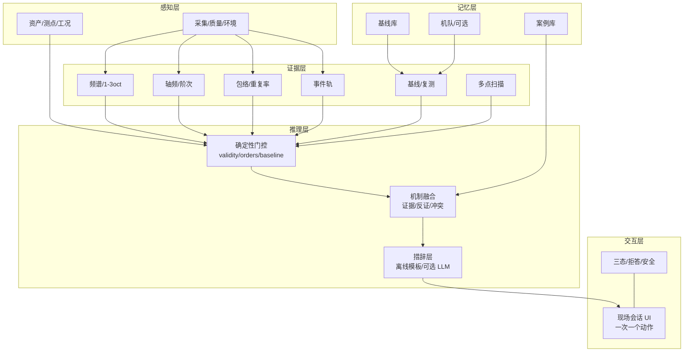
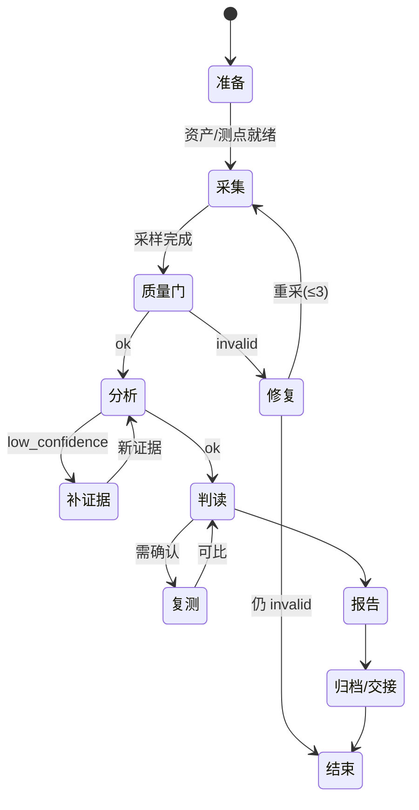

# 02 · 听诊仪全盘设计大纲

> 一句话：**听诊仪不是“把监测页换个皮”，而是把诊断变成一次可复现的现场实验。**
> Agent 的职责是“决定下一次测什么”，不是“决定是什么故障”。

## 0. 结论先行

1. **定位**：面向泵房/机房巡检的现场声学诊断助手 + 证据记录仪；不是声级计、不是在线监测、不是故障分类器、不是振动替代。[F]
2. **核心取舍**：放弃“连续监测 + 自动告警”，换成“任务会话 + 受控实验 + 复测对比 + 交接包”。这让单麦的物理局限变成可管理的流程约束，而不是伪装成能力。[I]
3. **三个可观测替身**：相对声级 dBFS 替代绝对 SPL；机制家族替代故障名；验证实验替代“建议检查”。[F]
4. **三态是一等公民**：`ok / low_confidence / invalid` 决定能说什么、不能说什么；invalid 时连“已排除”都不说。[F]
5. **离线优先**：核心链路零网络；音频默认不上传；报告/案例/基线全部本地可导出、可复现。[F]
6. **视觉以 07 浅色 token 为准，交互重做**：深色仅手动反转、状态色、证据卡、事件轨保留；设备列表、24h 漂移、告警中心删除。[F/I]
7. **落地顺序**：先复用 DSP/测试/APK 壳跑通 MVP，再上 Agent；详见 05。[I]

---

## 1. 产品定位与非目标

### 1.1 一句话定位

**听诊仪 = 工程师在泵房里的“声学听诊 + 实验设计 + 留证交接”工具。**
它帮你在 5–15 分钟内完成：到点 → 对准 → 采集 → 判定 → 复测 → 报告 → 归档。

### 1.2 名字

- 中文主名固定：**听诊仪**。
- 候选英文名/副标题（待商标检索 `[U]`）：
  - `Ausculto — Field Acoustic Diagnostic Assistant`（推荐，含义准确、非“monitor”）
  - `PumpScope`（更工具化，但易与内窥镜混淆）
  - `SoundRound`（更服务化，偏“巡检”）
- 产品内不使用 `Monitor / Monitoring` 作为主词，避免回到旧范式。

### 1.3 目标（可判定）

| 目标 | 判据 |
|-|-|
| 一次现场闭环 ≤15 分钟 | 首次案例中位数 ≤15min；复测 ≤6min |
| 结论可复核 | 报告含 8 项元数据 + 哈希；他人可复现同点同工况 |
| 不可信数据不出结论 | 六类 invalid 注入全部命中；invalid 时 0 条方向输出 |
| 不越界 | 0 条绝对 SPL、0 条未放行故障名、0 条定位/源分离/RUL |
| 离线可用 | 飞行模式下完成采集→判读→报告→导出 |

### 1.4 非目标（明确不做）

| 非目标 | 原因 |
|-|-|
| 声级计/计量器具 | 手机未校准；绝对 SPL 不可测 |
| 24h 在线监测/告警 | 现场不需要；数据/隐私/成本高 |
| 故障自动分类/命名 | 未过 13 号放行门槛；不可辨识 |
| 单麦源分离/定位 | 零空间自由度 |
| 剩余寿命/RUL | 无退化模型/无真值 |
| 替代振动/油液/温度 | 声学只是筛查 |
| 医疗/安全认证决策 | 非认证设备；安全边界 |
| 通用“AI 诊断” | 空话；只做可验证的证据融合 |
| 外接麦克风/校准声级计 | 决策 D1：只用手机自带麦；无外设标定流程 |
| 云端账号/云同步/云推理 | 决策 D3：纯本地；模型可端侧，但必须有模板回退 |

---

## 2. 目标用户与现场场景

### 2.1 用户

| 角色 | 诉求 | 关键约束 |
|-|-|-|
| 一线巡检工程师（主） | 快速判断“这台泵今天有没有事、要不要上报” | 戴手套、单手、泵房噪声、网络差、时间紧 |
| 设备主管/可靠性工程师（次） | 复核结论、比较历史、决定检修 | 要证据链、要版本、要可追溯 |
| 维修班组 | 按报告施工、修后验收 | 要明确动作、要安全前置 |
| 第三方维保 | 跨客户交付 | 要报告、要交接、要权限隔离 |
| 接班工程师 | 接着上次继续 | 要“做到哪、还差什么、下一步” |

### 2.2 五个现场场景

| 场景 | 目标 | 约束 | 成功判据 | Agent 行为 |
|-|-|-|-|-|
| S1 首次巡检 | 建立测点、发现粗大异常、决定是否建基线 | 无历史、时间 10–15min | 几何完整、3 工况、质量 ok、报告注明“无基线” | 引导建档/布点；无基线时只给“形态异常/需复测”，不做趋势 |
| S2 复测对比 | 判断“变了没有、变多少” | 同点同工况、设备/算法版本一致 | 兼容性门通过；Δ≤1.5dB 才可比；结论三态 | 先查可比性，再算 delta；不可比直接拒答 |
| S3 故障复现 | 抓住间歇故障 | 故障不常出现、需触发 | 事件轨有原始帧；工况/时间戳完整 | 设计扰动（加载/阀门/启停），一次只改一个变量 |
| S4 维修后验收 | 证明“修好了/没修好” | 修前修后同协议 | 同点同工况复测；残余异常分/事件率 | 强制修前基线；无修前数据则降级为“首次” |
| S5 跨班交接 | 让接班人复现 | 不同人/不同手机 | 交接包字段完整；接班人 10min 内复现 | 生成交接包：结论/证据/未决/下一步/安全 |

可选 S6 应急初筛：2–3 分钟，只看“能否判读 + 有无明显异常”，其余拒答。用于“先去看一眼”的场景。

### 2.3 场景到流程的映射

- S1/S4 需要“基线/验收”分支；S2 需要“可比性门”；S3 需要“扰动/事件”；S5 需要“交接包”。
- 所有场景共享同一会话状态机，只是入口与必填项不同（见 03 §7）。

---

## 3. 端到端现场流程

```
准备 → 认机/建档 → 测点 → 采集 → 判读 → 复测 → 报告 → 归档/交接
```

| 步 | 输入 | Agent 动作 | 工具 | 通过门 | 输出 | 时间 |
|-|-|-|-|-|-|-|
| 0 准备 | 任务、设备、环境、安全 | 查历史、问三件事（设备/测点/工况） | `asset.resolve` | 安全清单确认 | 会话卡 | 1–2min |
| 1 认机/建档 | 二维码/铭牌/照片 | 绑定 asset；补型号/转速/叶片/极数 | `asset.resolve`、`point.define` | 资产唯一、关键参数齐 | asset_id | 1–2min |
| 2 测点 | 位置、距离、朝向、照片 | 选点；记录几何；测背景 | `point.define`、`quality.evaluate` | 几何完整；背景可辨 | point_id + 几何 | 1–2min |
| 3 采集 | 工况、时长 | 引导稳态；采 3 工况各 ≥30s | `capture.acquire`、`quality.evaluate` | 三态 ok；阶次可用 | 原始帧 + 特征 | 3–6min |
| 4 判读 | 证据包 | 机制假设 + 证据/反证 + 验证实验 | `spectrum.compute`、`orders.track`、`envelope.compute`、`events.detect`、`baseline.compare` | 无禁止输出；三态表达 | 判读卡 | 1–2min |
| 5 复测 | 同点/同工况/扰动 | 设计一次确认测量；查可比性 | `protocol.perturb`、`retest.compare` | 回访首点 Δ≤1.5dB | 对比卡 | 2–4min |
| 6 报告 | 会话 | 生成一页纸 + 附录 + manifest | `report.build` | 8 项元数据齐全 | PDF/MD/JSON | 1min |
| 7 归档/交接 | 案例 | 存案例；生成交接包 | `case.archive`、`handover.pack` | 字段完整；权限允许 | 案例 + 交接包 | 1min |

### 3.1 每次会话的最小必填

- asset_id、point_id、几何（距离/高度/朝向/照片）、工况（转速/流量/负载）、采样率真值、设备型号/OS、操作者、时间。
- 缺任何一项 → 报告不能生成，只能存草稿。

### 3.2 时间预算

| 场景 | 目标中位数 | 上限 |
|-|-|-|
| 首次巡检 | 12–15min | 20min |
| 复测 | 5–6min | 10min |
| 应急初筛 | 2–3min | 5min |
| 交接复现 | 8–10min | 15min |

> 时间不是 KPI 本身；**没有足够证据的“快”** 会变成误判。超时优先砍“多点扫描”，不砍“质量门”。

---

## 4. Agent 分层架构



### 4.1 各层职责与禁止项

| 层 | 职责 | 禁止 |
|-|-|-|
| 感知层 | 采集、质量、环境、上下文；只产出“数据是否可信” | 不做诊断、不解释故障 |
| 证据层 | 确定性计算：谱/阶次/包络/事件/基线/多点；每个数带来源、参数、版本 | 不生成“故障名”；不把降噪结果当判决 |
| 推理层 | 门控、融合、冲突处理、选择下一证据；LLM 只把结构化证据转成现场话术 | 不生成物理量；不覆盖工具输出；不猜故障 |
| 交互层 | 一次一个动作、三态、拒答、安全前置、报告/交接 | 不诱导越权操作；不在 invalid 时给方向 |
| 记忆层 | 案例/基线/机队；检索“上次做到哪、验证过什么” | 不把未验证结论当事实；不跨租户 |

### 4.2 三层不变量（实现必须遵守）

1. **工具优先**：任何数值只能来自工具输出；LLM 不得自行计算/外推。
2. **门控优先**：`validity`/`orders`/`baseline` 的 invalid 优先于任何机制分；冲突时取更低置信。
3. **证据可追溯**：每个结论字段必须能指回 `session_id + tool + params + version`。

### 4.3 运行形态

| 形态 | 能力 | 适用 |
|-|-|-|
| 纯本地规则（默认） | 工具 + 模板话术 + 三态/拒答 | 无网、低端机、现场 MVP |
| 本地小模型（可选） | 话术润色/问答 | 有 NPU/内存足够 `[U]` |
| 网络权限 | 无 | 纯本地离线；无在线 LLM 路径，不传任何数据 |

> 三种形态共用同一 JSON 契约（03 §8）；离线模板必须能独立通过 §11 的验收。

---

## 5. 能力边界与拒答策略

### 5.1 边界矩阵

| 用户请求 | 能否 | 回复策略 | 替代 |
|-|-|-|-|
| “多少 dB？” | **不能** | 明确“未校准相对声级，不能给 dB SPL” | 显示 dBFS + 相对差 |
| “是不是轴承坏了？” | **未放行不能** | “冲击类机制可疑，需复测/振动复核” | 包络重复率 + 验证实验 |
| “是哪个轴承/叶片？” | **不能** | “单麦无方位，无法定位” | 多点扫描只给表面相对差异 |
| “帮我把泵和风机分开” | **不能** | “单麦不能分离同时声源” | 停机对照/阶次/扰动 |
| “还能用多久？” | **不能** | “无退化模型，不能给 RUL” | 复测趋势 + 检修建议 |
| “早期微裂纹能听出来吗？” | **不能** | “声学灵敏度不足” | 振动/油液/温度 |
| “没基线，趋势怎样？” | **不能** | “无基线不做趋势” | 本次形态 + 建议建基线 |
| “噪声太大，能测吗？” | **看 SNR** | <10dB 拒答；10–24 降级 | 近场/隔声/停机对照 |
| “变频瞬态呢？” | **看稳态** | 非稳态窗拒答 | 稳定工况窗口 |
| “并排机组呢？” | **需隔离** | 串扰未隔离则拒答 | 近场/隔声/停机 |
| “声源在哪个方向？” | **有条件** | 双麦且已标定、直达声主导才给左右半平面（±30° 量级）；否则“方向不可判” | 单麦多点顺序扫描 |
| “两路哪个更响/差多少 dB？” | **不能** | 两麦频响/增益不同，禁止跨通道比幅 | 只做时间差与一致性 |
| “帮我指导拆机” | **不能** | 安全边界外 | 持证人员按规程 |

### 5.2 拒答的四个等级

| 等级 | 含义 | 表达 | 例 |
|-|-|-|-|
| R0 | 可答 | 结论 + 证据 + 把握 | “本次可判读；1× 偏高；建议复测确认” |
| R1 | 可答但降级 | `low_confidence` + 缺什么 | “证据不足，只能给方向：先补 30s 常用工况” |
| R2 | 本次不可答 | `invalid` + 修复动作 | “削顶，本次数据不可用；请退到 0.5m 重采” |
| R3 | 永久不可答 | 边界声明 + 替代 | “绝对 SPL 不可测；如需计量请用校准声级计” |

### 5.3 拒答话术结构（必须四段）

1. **结论**：能/不能。
2. **原因**：缺哪个物理量/哪个门没过（用数字）。
3. **下一步**：一个可执行动作（不是“建议进一步检查”）。
4. **边界**：这是筛查，不是计量/不是拆检结论。

> 反例：“信号质量不佳，建议重新测量”——没有说哪个门、没有说怎么改，等于没说。

### 5.4 双麦能力边界（决策 D1 收口）

> 第二颗麦（顶部降噪麦）是**有条件可用**，不是默认能力。先探测，再放行；探测失败一律单麦模式。

| 能力 | 承诺级别 | 前提 | 不可承诺 |
|-|-|-|-|
| 通道一致性（哪一路削顶/AGC/掉帧/被处理） | **可承诺** | 立体声探测通过（非复制通道） | 跨通道幅度谁更响 |
| 近场/远场粗判 | **可承诺（定性）** | 双通道相干性可算 | 距离数值 |
| 直达声主导下的左右半平面 | **可承诺（±30° 量级）** | 已标定 + 相干 ≥0.6 + 峰突出 ≥6dB + τ 稳定 σ≤0.5 sample | 角度精度、仰角、三维方向 |
| 单麦失效检测 | **可承诺** | 双通道独立 | 用副麦替代主麦做判决 |
| 源分离/部件定位 | **不承诺** | — | 任何形式 |

**物理红线（写死在代码与提示词）**

- 空间 alias：`f > c/(2d)`；d=0.12m 时约 **1.4kHz** 以上相位模糊，方向工作带固定 **200–1200Hz**。
- 1 sample @48k = 20.8µs ≈ 7.1mm 路径差；必须亚采样插值到 0.1 sample。
- 混响/反射破坏 TDOA：只在直达声主导时给方向，否则 `unknown`。
- 两麦频响/增益不同：**禁止**跨通道比幅、禁止用双麦推算绝对声压。
- 双麦不提升故障名置信；故障名放行仍按 03 §6。

**降级链**：`探测失败 → 单麦（标注）`；`单路 AGC/削顶 → 剔除该路 → 单麦`；`未标定 → 方向 unknown`；`相干不足 → 方向 unknown`。任何降级都不得隐藏“单麦模式”标注。

---

## 6. 置信度与三态

### 6.1 定义

| 状态 | 条件（全部满足才 ok） | 能说什么 | UI |
|-|-|-|-|
| `ok` | 质量 ok；阶次可用（若涉及阶次）；基线可用（若涉及趋势）；无冲突；把握中/高 | 机制 + 证据 + 验证实验 | 绿色“本次可判读”；把握高/中 + 3 条依据 |
| `low_confidence` | 数据有效，但缺基线/SNR 10–24/方向分离不足/证据冲突/单次用于对比 | 只给方向 + 缺什么 + 一个补测动作 | 黄色“证据不足”；不显示方向排序 |
| `invalid` | 任一硬门失败（削顶/AGC/采样率/掉帧/静音/权限/阶次不足） | **什么都不给**（含“已排除”） | 红色“本次数据不可用”；只给修复清单 |

### 6.2 表达规范

- **主视图不显示百分比**；只显示“把握 高/中/低”+ 三条依据（如 SNR 28dB、基线 42 帧/3 档、方向分离 0.31）。
- 百分比只在“技术详情”出现，且标注“工程分，非故障概率”。
- `low_confidence` 不得把候选机制排序成“第 1/第 2”，避免锚定；用无序列表 + 证据计数。
- `invalid` 必须**隐藏**所有方向卡，不是置灰；置灰仍会锚定。
- 禁止用“正常”描述 `low_confidence`；正确说法是“未见可判读异常（证据不足）”。
- 报告首页必须复述三态与限制；不能只写“结论”。

### 6.3 三态在会话中的转换



---

## 7. 离线优先与本地数据模型

### 7.1 原则

1. 核心链路（采集/分析/判读/报告/导出）**零网络**。
2. 原始音频**默认不留存、不上传**；只有用户显式开启“片段”时才保留触发前后各 3s，加密、限期、二次确认导出。
3. 所有实体带 `schema_version` 与 `algorithm_version`；升级可迁移、可回滚。
4. 报告/案例可导出为单文件包，含 manifest 与哈希。

### 7.2 数据实体

| 实体 | 关键字段 | 说明 |
|-|-|-|
| `Site` | id, name, customer, tenant | 现场/客户 |
| `Asset` | id, site_id, model, serial, rpm, blades, poles, bearing_geom?, qr | 设备 |
| `Point` | id, asset_id, distance_m, height_m, orientation, photo, background_id, placement_fp | 测点；baselineKey 的核心 |
| `Condition` | rpm, flow_ratio, valve_pct, load_pct, state | 工况档 |
| `Session` | id, mode, operator, started_at, quality_state, protocol_version, app_build | 一次现场会话 |
| `Capture` | id, session_id, condition, sample_rate_true, duration, raw_ref, features_ref | 采集 |
| `Evidence` | id, capture_id, type, params, values, unit, tool_version | 证据原子 |
| `Baseline` | id, point_id, condition_bucket, frames, created_at, gate_version, status | 基线 |
| `Case` | id, session_id, asset_id, state, hypothesis_ids, next_action, labels | 案例 |
| `Report` | id, session_id, manifest, hashes, version | 报告 |
| `Handover` | id, case_id, from, to, open_items, safety | 交接 |
| `User/Shift` | id, role, shift, tenant | 权限/班次 |
| `SyncQueue` | op, entity, payload, retry | 可选同步 |

### 7.3 音频与存储策略

| 项 | 策略（决策 D4 收口） |
|-|-|
| 原始格式 | 48k / 16bit / mono PCM；禁止压缩/蓝牙通路作判决 |
| 原始音频 | **默认不留存（`retain_raw=false`）**；仅保留特征、证据图与哈希 |
| 片段（可选） | 触发前后各 3s（6s）；WAV 576KB 或 FLAC≈300KB；AAC 仅试听副本、标 `non_evidentiary` |
| 片段安全 | AES-256-GCM，密钥在 Android Keystore；扩展名 `.tzclip`；默认 30 天，启动清理 |
| 片段导出 | 二次确认 + 填写原因 + 记录 `exported_at`；提示可能含人声 |
| 特征保留 | 电平/谱/阶次/包络/事件/双麦/质量/版本（字段清单见 06 §8.3） |
| 报告证据 | 原始帧渲染 PNG（非缩放截图）+ 参数；≤300KB/张 |
| 容量 | 默认上限 2GB；超 80% 提示导出；报告/案例元数据不淘汰 |
| 导出 | `.tzcase` zip：manifest.json + report.md/pdf + evidence/*.png + features.json + clip（可选） |
| 备份 | 本地导出/导入；无云同步；企业策略可强制导出到受控目录 |
| 证据强度 | 默认“可复核”≠“可重算”；报告必须写 `raw_available=false` |

### 7.4 旧数据迁移

- 只读导出旧 localStorage 六类键 → `legacy_import.json`；不直接改旧 key。
- 映射：旧设备 → `Asset`；旧基线 → `Baseline`（缺几何则标 `unverified`，不可用于趋势）；旧事件 → `Case` 备注。
- 迁移失败可回滚；迁移前必须备份。

---

## 8. 报告与留痕

### 8.1 报告结构（一页纸 + 附录）

1. **首页**：三态、一句话结论、关注级别、建议下一动作、限制声明。
2. **设备与测点**：型号/序列/转速/叶片/轴承几何（若有）；距离/高度/朝向/照片。
3. **工况与质量**：三工况、采样率真值、AGC/削顶/掉帧、SNR、阶次可用性。
4. **证据表**：1/3oct、阶次、包络、事件、基线/复测；每项带参数与版本。
5. **机制假设**：候选机制、支持证据、反证、验证实验；不写故障名。
6. **复测/对比**：可比性、delta、结论。
7. **限制**：单麦、无绝对 SPL、无定位、无 RUL、非计量。
8. **交接**：未决项、下一班动作、安全提示。
9. **manifest**：8 项元数据 + 哈希 + 版本四元组（build/commit/包哈希/证书哈希，受控展示）。

### 8.2 可追溯的 8 项（缺一不出报告）

1. 证据截图（原始帧，非缩放）。
2. 工况（rpm/流量/阀位/负载/稳态）。
3. 基线版本与建立时间（或“无基线”）。
4. 算法版本与关键参数（窗长/FFT/门限/权重）。
5. 采样率真值（不是“48k 假设”）。
6. 设备型号/OS/麦克风位置。
7. 几何（距离/高度/朝向/照片）。
8. 哈希（raw/证据/报告）+ 发布四元组。

### 8.3 可复现检查（接班人能重做）

- 同点、同距离/朝向、同工况、同 App/算法版本。
- 回访首点 1/3oct 差 ≤1.5dB；否则“工况/摆位变了”，对比作废。
- 报告必须写“怎么重做”，不是只写“结论”。

---

## 9. 权限与隐私

| 项 | 策略 |
|-|-|
| 麦克风 | 仅采集时开启；前台可见指示；禁止后台常驻 |
| 相机 | 仅扫码/拍照建档；不默认上传 |
| 位置 | 可选；默认不记录精确坐标；站点名可脱敏 |
| 音频 | **默认不留存、不上传**；片段需显式开启、加密、限期；导出二次确认 |
| 租户 | 数据隔离；跨租户默认不可见；机队对比需授权 |
| 角色 | viewer / operator / lead / admin；报告导出受角色控制 |
| 留存 | 案例/特征默认 180 天；片段默认 30 天；删除即删（含证据） |
| 日志 | 不含原始音频/PII；站点名可哈希 |
| 第三方 | 默认无广告/无分析 SDK；崩溃日志 opt-in；端侧模型不联网 |
| 密钥 | 见内部交底 04；不写入任何产品文档/代码库 |

---

## 10. 交互与视觉（继承 08/09 的部分）

### 10.1 继承

- 色板以 07 §2.1 浅色 token 表为准（深色仅手动反转）；状态色只表达状态；等宽数字；最小 12px；触控 ≥48px。
- 信号健康条常驻采集页（AGC/削顶/SNR/采样率/权限）。
- 证据卡：基线 vs 当前叠加 + 偏离高亮；事件轨独立。
- 低置信不显示数字；空态给下一步。
- 无装饰动效；200ms 淡入；不做横向滑动。

### 10.2 重做

| 旧 | 新 |
|-|-|
| 设备列表首屏 | 今日任务/待复测/待交接 |
| 24h 漂移热力图 | 测点×工况×复测矩阵（仅会话） |
| 告警中心/推送/沉默期 | 案例收件箱/待复核清单 |
| 健康分 | 三态 + 关注级别 |
| “这不是异常”自动调阈值 | 只记录反馈，人工复核 |
| 5 分钟基线 | 验收/出厂基线 + 显式重建 |
| 波形首屏 | 任务/质量/证据首屏 |

### 10.3 现场可用性硬指标

- 单手可完成一次采集；关键按钮在拇指区。
- 戴手套可点；误触有确认（删除/重建基线/导出）。
- 强光下对比度 ≥4.5:1；字号 ≥12px；数字 ≥16px。
- 断网无白屏；失败有“下一步”。

### 10.4 关于/联系入口

- 设置 →「关于听诊仪」：产品名、版本、作者、联系邮箱 `luhuqiang@foxmail.com`、隐私政策、开源许可、`algorithm_version`、发布四元组（受控展示）。
- 报告页脚固定联系入口：`听诊仪 · luhuqiang@foxmail.com` + 报告 ID + 版本；不展示任何密钥/证书指纹。
- 首次启动与导出报告时各展示一次，满足“可追溯 + 可联系”。

---

## 11. 指标与验收口径

| 指标 | 定义 | 目标 | 测量 |
|-|-|-|-|
| 诊断命中（机制级） | 与专家盲判 top-1 机制一致 | ≥70%（50 例）`[U]` | 双盲 |
| 误报（高把握错误） | 输出 ok 且机制错 | 0（红线）；字段审计 ≤5% | 标注集/现场审计 |
| 拒答率 | 证据不足时拒答/应拒答 | ≥90% | 脚本化 50 例 |
| invalid 召回 | 六类注入全部 invalid | 100% | 真机注入 |
| 现场耗时 | 首次/复测中位数 | ≤15/6min | 计时 |
| 复测重复性 | 同点同工况两次 1/3oct 差 | ≤1.5dB；三态一致 ≥90% | 30 次 |
| 报告完整率 | 8 项元数据齐全 | 100% | 自动校验 |
| 交接复现率 | 接班人 10min 内复现 | ≥80% | 演练 |
| 离线成功率 | 飞行模式完成闭环 | 100% | 演练 |
| 崩溃率 | crash-free sessions | ≥99.5% | 日志 |

> “诊断命中”在没有真值标注前只能算“专家一致率”；不能对外称准确率。`[F]`

---

## 12. 实现约束与迁移（摘要）

- 复用：`audio/*` 纯函数、golden/status 测试、WebView 壳、QR/NativeBridge、report 字段。
- 改造：diagnose/status-priority/settings/check:apk/license。
- 重做：首屏/会话流、IndexedDB、案例/测点/交接、Agent、报告 2.0、静态构建。
- 废弃：24h 监护/告警/推送、健康分、SSR/auth/DB、强制授权、PWA 平台红。
- 工作量：MVP 39–52 人日；完整 75–105；双麦+端侧模型合计 +13–19；含样本放行 88–125。详见 05 与 06 §14。

---

## 13. 风险与决策收口

### 13.1 决策收口（v1.0，2026-11-03）

| # | 决策 | 对产品形态的影响 | 落点 |
|-|-|-|-|
| D1 | 只用手机自带麦；第二颗麦必须探测后使用 | 双麦从“不可用”变“有条件可用”；单麦模式为一等状态 | §5.4 |
| D2 | 故障名只承诺汽蚀、堵塞 | 其余机制永久“疑似/需复测”；放行门逐类 | 03 §6 |
| D3 | 纯本地；可选端侧模型 + 模板回退 | Agent 默认规则/模板；模型只改措辞 | 06 §7 |
| D4 | 原始音频默认不留存、不上传 | 证据链从“可重算”降为“可复核”；片段需显式开启 | §7.3 |
| D5 | 沿用旧包名与既有证书升级 | 改名不改身份；覆盖安装、数据迁移成为发布门禁 | 06 §13 |

### 13.2 残余风险（仍需工程验证，不是开放问题）

| 风险 | 影响 | 缓解 |
|-|-|-|
| 多数机型立体声为复制通道/单麦 | 双麦价值落空 | 探测先行；单麦闭环完整；宣传不承诺 |
| 顶部麦被 HAL 做 NS/AGC/HPF | 方向不可用 | P6/P7/P10 探测；不通过即禁用方向 |
| 混响破坏 TDOA | 方向误判 | 相干/峰突出/稳定三门；unknown 优先 |
| 端侧模型内存/发热 | 卡顿/耗电 | 可选加载；3s 超时；会话熔断 |
| 旧数据迁移失败 | 基线丢失 | 升级前自动备份；迁移可回滚 |
| 把“机制”说成“故障” | 误导/责任 | 文案红线 + 放行门 + 审计 |
| 无基线首次巡检 | 只能给方向 | 明确三态；不做趋势 |
| 多点扫描工况漂移 | 伪空间差异 | 回访首点 ≤1.5dB |
| 手机碎片化 | 三态误判 | 真机六项 + 机型白名单 |
| 报告不可复核 | 交接断链 | manifest 8 项 + 哈希 |

---

## 变更记录（v0.9-draft → v1.0，2026-11-03）

| 版本 | 变更 | 涉及章节 |
|-|-|-|
| 0.9-draft | 初稿：定位、场景、Agent 分层、页面与验收 | 全文 |
| 1.0 | D1：非目标新增“外接麦克风/校准声级计”；新增 §5.4 双麦能力边界（承诺级别/物理红线/降级链） | §1.4、§5.4 |
| 1.0 | D2：故障名收窄为汽蚀/堵塞；拒答矩阵加“方向（有条件）/跨通道比幅（不能）” | §5、§6 |
| 1.0 | D3/D4：离线原则改“默认不留存、不上传”；音频策略表改 6s 片段/AES-256-GCM/30 天 | §7、§9 |
| 1.0 | 工作量口径改 MVP 39–52、完整 75–105、含双麦+模型 88–125；§13 由开放问题改为决策收口 + 残余风险 | §12、§13 |

## 14. 元信息

- 作者：luhuqiang；联系：`luhuqiang@foxmail.com`。
- 产品中文主名：听诊仪；英文候选见 §1.2（待商标检索）。
- 版本 1.0（决策收口版）；与 00/01/03/04/05/06 同批交付。
