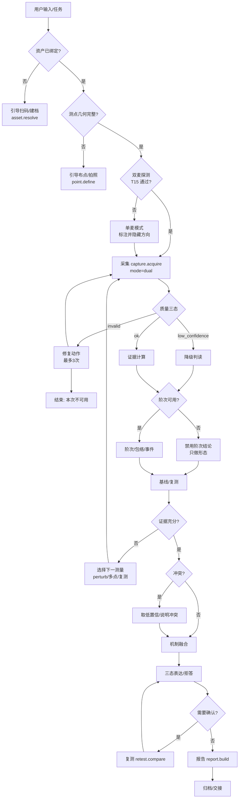

# 03 · 听诊仪 Agent PRD

## 文档控制

| 项 | 值 |
|-|-|
| 产品名 | 听诊仪（Ausculto，候选） |
| 文档版本 | 0.9-draft |
| 目标版本 | v1.0 现场 MVP → v1.2 完整 Agent |
| 作者/联系 | luhuqiang / `luhuqiang@foxmail.com` |
| 变更规则 | 任一判据/门限/窗长/权重变更 → 升 `algorithm_version` + 补 golden test |
| 评审结论 | 待评审（本文所有 `[U]` 项需在 M0 关闭） |

## 0. 结论先行

1. 这个 Agent 的产品价值不在“会聊天”，而在**会做实验**：它调度采集、质量门、阶次、包络、事件、基线、复测，并决定下一次测什么。[I]
2. 它的能力上限由物理决定：**不做绝对 SPL、不做单麦定位/源分离、不做未放行故障名、不做 RUL**；越界即事故。[F]
3. 它的第一交互不是“回答”，而是**三态与拒答**：invalid 时只给修复动作；low 时只给方向 + 补测；ok 才给机制 + 验证实验。[F]
4. 它的可信度来自**可追溯**：每个数字指回工具/参数/版本/原始帧；报告缺 8 项元数据就不生成。[F]
5. 它的落地顺序是“先复用 DSP/测试/壳跑通会话，再上 Agent”；MVP 40–55 人日，完整 75–105 人日。[I]

---

## 1. 背景与问题

### 1.1 现状

旧产品“泵噪监测台”Build 4/v1.3 已具备：48k 采集、1/3oct、轴频跟踪、包络、事件轨、基线、报告、APK 壳。但它把产品定义成“常驻在线监护仪表”：设备列表、24h 漂移、告警中心、健康分、推送/沉默期。现场工程师真正要做的是“到点、对准、采集、判定、留证、交接”，两者不匹配。[F]

### 1.2 五个真问题

| # | 问题 | 证据 |
|-|-|-|
| P1 | 绝对 SPL 不可测，却被 `splAt0` 暗示可测 | 01 §2.3；12 §5 |
| P2 | 单麦不能分离/定位，却被“多故障分类”暗示可行 | 01 §2.2/2.6；03 §1.4；05 §2.1 |
| P3 | 故障名无标注放行，却被 UI 当结论 | 01 §2.6；13 §6.2 |
| P4 | 门限自适应会把劣化学成正常 | 01 §2.5；15 §4；16 §2.2 |
| P5 | 现场闭环缺失：无测点几何、无案例、无交接、报告缺版本/哈希 | 05 §3；15 §2.4 |

### 1.3 为什么是 Agent，而不是“加一个聊天框”

现场诊断的本质是**序贯实验**：先测什么、结果够不够、下一步改哪个变量。这正好是 Agent 的强项——**选择下一次工具调用**。但 Agent 不能发明物理量，也不能替用户下故障结论；它只做“证据调度 + 话术 + 拒答”。[I]

---

## 2. 目标与非目标

### 2.1 目标（可判定）

| ID | 目标 | 判据 |
|-|-|-|
| G1 | 一次现场闭环 ≤15min | 首次中位数 ≤15min；复测 ≤6min |
| G2 | 不可信数据零结论 | 六类 invalid 注入 100% 命中；invalid 时方向输出 0 条 |
| G3 | 证据不足必拒答 | 50 条脚本化会话，应拒答 ≥90%，高把握错误 0 |
| G4 | 结论可复核 | 报告 8 项元数据 100%；他人可复现同点同工况 |
| G5 | 不越界 | 0 条绝对 SPL/未放行故障名/定位/源分离/RUL |
| G6 | 离线可用 | 飞行模式完成采集→判读→报告→导出 100% |
| G7 | 交接可复现 | 接班人 10min 内复现 ≥80% |

### 2.2 非目标

- 不做声级计/计量；不做 24h 在线监测/告警；不做自动故障分类（未过门）；不做单麦源分离/定位；不做 RUL；不替代振动/油液/温度；不做医疗/安全认证决策。
- 不接外接麦克风/校准声级计/多通道阵列（决策 D1）；不做云端账号/同步/推理（D3）；不做精细角度/仰角/距离估计（双麦仅半平面）。
- 故障名只承诺**汽蚀、堵塞**两类（D2）；不承诺其他故障名，永久只到“机制家族 / 疑似 / 需复测”。

---

## 3. 用户画像与关键场景

| 画像 | 目标 | 痛点 | Agent 必须 |
|-|-|-|-|
| 一线巡检（主） | 快速判断要不要上报 | 时间紧、戴手套、网络差 | 一次一个动作；默认值；离线 |
| 设备主管 | 复核/比较/决策 | 报告不可追溯 | 证据链/版本/哈希 |
| 维修班组 | 按报告施工/验收 | 建议不可执行 | 明确动作 + 安全前置 + 回填 |
| 接班人 | 接着干 | 不知道做到哪 | 交接包 + 未决项 |

五个场景（S1–S5）见 02 §2.2；本 PRD 的验收脚本必须覆盖每个场景至少 10 条。

---

## 4. Agent 角色定义与职责边界

### 4.1 角色

**听诊仪 Agent = 现场声学诊断的实验调度员 + 证据书记员 + 边界守门人。**
一句话：**它决定下一次测什么、证据够不够、什么时候闭嘴；它不决定“是什么故障”。**

### 4.2 职责（必须做）

1. 解析任务与场景（首次/复测/复现/验收/交接）。
2. 检查前置：资产、测点几何、工况、安全确认。
3. 调度采集与质量门；invalid 时只给修复动作。
4. 调度证据工具：谱/阶次/包络/事件/基线/多点/复测。
5. 证据融合：支持/反证/冲突；选择下一个最有判别力的测量。
6. 三态表达与拒答；生成报告/交接包。
7. 记录“验证过什么/排除了什么”，供下次使用。

### 4.3 不做什么（红线）

| 禁止 | 原因 | 替代 |
|-|-|-|
| 生成/外推物理量 | 不可追溯 | 只引用工具输出 |
| 输出 dB SPL | 未校准 | 相对 dBFS + 差 |
| 输出未放行故障名 | 不可辨识/无标注 | 机制家族 + 验证实验 |
| 单麦定位/源分离 | 零空间自由度 | 多点顺序/扰动/阶次 |
| RUL/早期微裂纹承诺 | 无模型/无真值 | 复测趋势 + 其他手段 |
| 覆盖工具/门控 | 安全 | 工具优先 |
| 指导越权操作 | 安全/法规 | 持证人员按规程 |
| 在 invalid 时给“已排除” | 锚定/误导 | 只给修复清单 |

### 4.4 权限矩阵

| 动作 | Agent | 用户 | 系统 |
|-|-|-|-|
| 开始/停止采集 | 提议 | 确认 | 执行 |
| 改工况（阀门/变频） | 提议 + 安全前置 | **必须人工执行** | 只记录 |
| 生成报告 | 执行 | 确认 | 存储 |
| 删除基线/案例 | 不执行 | 确认 + 二次确认 | 执行 |
| 导出/上传 | 提议 | 确认 | 执行 |
| 故障名 | 未放行不输出 | 可人工标注 | 审计 |

---

## 5. 工具清单（输入/输出/失败语义）

> 所有工具：纯本地、确定性、幂等（同输入同输出）；返回结构化错误，不抛裸异常。
> 每个输出必须带 `provenance`：`tool_version + params_hash + algorithm_version + captured_at`。

### T01 `asset.resolve`

| 项 | 内容 |
|-|-|
| 用途 | 二维码/铭牌/序列号 → 资产；或新建草稿 |
| 输入 | `site_id?`, `qr?`, `serial?`, `nameplate_photo?`, `manual{model,rpm,blades,poles,bearing_geom?}` |
| 输出 | `asset_id`, `match_confidence`, `candidates[]`, `created_draft` |
| 失败 | `E_ASSET_NOT_FOUND`、`E_ASSET_AMBIGUOUS`（给候选，不猜） |
| 备注 | 关键参数缺失 → 仍可建档，但采集前必须补齐 rpm |

### T02 `point.define`

| 项 | 内容 |
|-|-|
| 用途 | 定义/更新测点几何；生成 `baselineKey` |
| 输入 | `asset_id`, `distance_m`, `height_m`, `orientation_deg`, `photo_ref`, `background_ref?`, `method(tape|laser|estimate)` |
| 输出 | `point_id`, `geometry_hash`, `placement_fp`（4–8k/1–2k 比） |
| 失败 | `E_GEOMETRY_INCOMPLETE`（缺距离/高度/朝向/照片） |
| 备注 | 距离默认 0.30m，允许 0.20–0.50m；超范围提示但可继续（降级） |

### T03 `capture.acquire`

| 项 | 内容 |
|-|-|
| 用途 | 48k 单通道采集，返回原始块与统计 |
| 输入 | `point_id`, `condition{rpm,flow_ratio,valve_pct,load_pct,state}`, `duration_s(10–120)`, `sample_rate_target=48000` |
| 输出 | `capture_id`, `sample_rate_true`, `blocks`, `rms_dbfs`, `peak`, `clip_count`, `agc_events`, `dropped`, `raw_ref` |
| 失败 | `E_PERMISSION_DENIED`、`E_MIC_BUSY`、`E_MIC_LOST`、`E_STORAGE_FULL`、`E_TOO_SHORT`、`E_UNSTEADY` |
| 备注 | 削顶/AGC/44.1k 不作为硬失败；由 T04 判 invalid，保留证据 |

### T04 `quality.evaluate`

| 项 | 内容 |
|-|-|
| 用途 | 三态与原因；所有结论的前置门 |
| 输入 | `capture_id` |
| 输出 | `state(ok|low_confidence|invalid)`, `reasons[]`, `metrics{sample_rate_true,snr_db,clip,agc,dropped,silence,steady}` |
| 失败 | `E_CAPTURE_NOT_FOUND` |
| 备注 | 确定性；无随机；`invalid` 时下游工具可算但不得出结论 |

### T05 `spectrum.compute`

| 项 | 内容 |
|-|-|
| 用途 | 1/3oct、谱特征、峰、带内 SNR |
| 输入 | `capture_id`, `fft_size(8192|32768|131072)`, `weighting=Z`, `bands` |
| 输出 | `bands[]`, `features{fund,harmonic2,bpf,half,hf,ratios}`, `peaks[]`, `snr_db`, `resolution{hz,enbw_hz,window_s}` |
| 失败 | `E_CAPTURE_INVALID`、`E_FFT_UNSUPPORTED` |
| 备注 | 判据只用 Z；A/C 仅显示（另一个工具或参数） |

### T06 `orders.track`

| 项 | 内容 |
|-|-|
| 用途 | 1×–5× 谐波梳、轴频、亚谐波、阶次 SNR |
| 输入 | `capture_id`, `rated_rpm`, `blades?`, `poles?` |
| 输出 | `f0_hz`, `sigma_hz`, `revs`, `comb[]`, `line_snr_db`, `rpm_mismatch_pct`, `subharmonic_ratio`, `reliable` |
| 失败（软） | `E_ORDERS_UNRELIABLE`：rpm<900、revs<20、line_snr<10、subharmonic>55%、转速不确定 |
| 失败（硬） | `E_RPM_REQUIRED` |
| 备注 | `reliable=false` 时不得输出任何阶次结论；谱特征仍可作形态描述 |

### T07 `envelope.compute`

| 项 | 内容 |
|-|-|
| 用途 | 1.5–6kHz 包络、冲击重复率、轴承阶次（若有几何） |
| 输入 | `capture_id`, `band_hz=[1500,6000]`, `bearing_geom?{n,d,D,angle}` |
| 输出 | `peaks[]`, `repetition_hz[]`, `orders?`, `mode(rate_only|order)` |
| 失败（软） | `E_BAND_EMPTY`、`E_GEOMETRY_MISSING` → `mode=rate_only` |
| 备注 | 无几何不得命名“内圈/外圈/滚珠”，只报重复率 |

### T08 `events.detect`

| 项 | 内容 |
|-|-|
| 用途 | 4096 点事件轨；crest/kurtosis；冻结门 |
| 输入 | `capture_id`, `gate_ref?`（该测点历史） |
| 输出 | `events[]`, `gate_status(frozen|unfrozen)`, `thresholds{crest_gate_z,event_z,p95}`, `publishable` |
| 失败（软） | `E_GATE_UNFROZEN` → 只记录，不报警、不进结论 |
| 备注 | 削顶/AGC 时 `publishable=false`；`crestGateZ` 与 `eventZ` 分开打印 |

### T09 `baseline.compare`

| 项 | 内容 |
|-|-|
| 用途 | 同点同工况基线偏离 |
| 输入 | `point_id`, `condition_bucket`, `features`, `baseline_version?` |
| 输出 | `status(ready|insufficient|stale)`, `d`, `score`, `dims[]`, `baseline_age_days` |
| 失败（软） | `E_BASELINE_INSUFFICIENT`（<30 帧或 <3 档）、`E_BASELINE_VERSION_MISMATCH` |
| 备注 | 不自动更新；维修事件后 baseline 删除；90d/500h 提示 stale |

### T10 `protocol.perturb`

| 项 | 内容 |
|-|-|
| 用途 | 选择一个最有判别力的工况扰动 |
| 输入 | `asset`, `current_condition`, `hypothesis_families`, `safety_ack` |
| 输出 | `next_condition`, `instruction`, `expected_discrimination`, `safety_notes` |
| 失败 | `E_UNSAFE_PERTURB`（无安全确认/越权）、`E_NO_DISCRIMINATING_PERTURB` |
| 备注 | 一次只改一个变量；变频/阀门由人工执行；记录稳态窗口 |

### T11 `retest.compare`

| 项 | 内容 |
|-|-|
| 用途 | 两次会话可比性 + delta |
| 输入 | `session_a`, `session_b` |
| 输出 | `comparable`, `reasons[]`, `deltas{bands,orders,events,score}`, `tolerance_db` |
| 失败（软） | `E_INCOMPARABLE`：几何/设备/工况/算法版本不一致；回访 Δ>1.5dB |
| 备注 | 不可比时禁止“变好/变坏”措辞 |

### T12 `report.build`

| 项 | 内容 |
|-|-|
| 用途 | 报告 2.0（一页纸 + 附录 + manifest） |
| 输入 | `session_id`, `audience(operator|lead|customer)`, `include_raw?` |
| 输出 | `report_id`, `md_ref`, `pdf_ref?`, `json_ref`, `manifest`, `hashes` |
| 失败 | `E_MISSING_METADATA`（8 项缺一）、`E_NO_EVIDENCE`、`E_EXPORT_FAILED` |
| 备注 | 缺项不出报告；限制声明必填 |

### T13 `case.archive`

| 项 | 内容 |
|-|-|
| 用途 | 案例入库、标签、下一动作 |
| 输入 | `session_id`, `labels?{mechanism,label_confidence}`, `next_action`, `handover_ready` |
| 输出 | `case_id`, `stored_bytes` |
| 失败 | `E_STORAGE_FULL`、`E_CASE_CORRUPT` |
| 备注 | `label_confidence=未知` 不进监督训练（13 §4.3） |

### T14 `handover.pack`

| 项 | 内容 |
|-|-|
| 用途 | 跨班交接包 |
| 输入 | `case_id`, `to_role`, `consent` |
| 输出 | `pack_id`, `summary`, `open_items[]`, `next_actions[]`, `safety[]`, `refs` |
| 失败 | `E_CONSENT_REQUIRED`、`E_CASE_INCOMPLETE` |
| 备注 | 摘要在 8 行内；必须含“没做完什么” |

### T15 `stereo.probe`

| 项 | 内容 |
|-|-|
| 用途 | 双麦能力探测与通道映射；决定 `dual` / `mono_fallback` |
| 输入 | `source_candidates[]`、`sample_rate=48000`、`occlusion_hint?` |
| 输出 | `mode`、`channels[{index, role, agc, clip, hpf, processed}]`、`reasons[]`、`d_eff_m?`、`calibration_state` |
| 失败 | `E_STEREO_UNSUPPORTED`、`E_CHANNELS_DUPLICATED`、`E_CHANNEL_AGC`、`E_CHANNEL_HPF`；失败不阻断采集，转 mono |
| 备注 | 按 `Build.MODEL + Build.ID` 缓存；探测耗时 ≤3s；结果写设备档案 |

### T16 `doa.coarse`

| 项 | 内容 |
|-|-|
| 用途 | 直达声主导下的左右半平面粗方向（GCC-PHAT） |
| 输入 | `capture_id`、`calibration`、`band=200–1200Hz` |
| 输出 | `side(left|right|front|unknown)`、`tau_samples`、`coherence`、`peak_prominence_db`、`sigma_tau`、`reasons[]` |
| 失败 | `E_CALIBRATION_REQUIRED`、`E_DIRECT_PATH_WEAK`、`E_CHANNEL_DEGRADED`；失败输出 `side=unknown`，不阻断 |
| 备注 | **只输出半平面**，不输出角度/距离；不得用于故障名；单麦模式直接 `unknown` |

### 5.1 工具与旧模块映射

| 工具 | 旧模块 | 复用/改造 |
|-|-|-|
| T03 | `meter.ts`/`capture.ts` + NativeBridge | 复用+扩展双通道 |
| T04 | `validity.ts` | 复用+扩展逐路 |
| T05 | `fft.ts`/`bands.ts`/`features.ts` | 复用 |
| T06 | `shaft-tracker.ts` | 复用+标定 |
| T07 | `envelope.ts` | 降级复用 |
| T08 | `event-rail.ts` | 复用 |
| T09 | `fingerprint.ts` | 复用，键改 point_id |
| T10 | 无 | 新增 |
| T11 | 无 | 新增 |
| T12 | `report.ts` | 升级 |
| T13/T14 | 无 | 新增 |
| T15/T16 | 无 | 新增（双麦子系统） |
| T01/T02 | `machine-qr.tsx`、settings | 改造 |

---

## 6. 能力放行条件（故障名/结论位）

> 来源：13 号样本方案；这是**硬门槛**，不是建议。

### 6.1 放行开关

- 全局 `FAULT_NAMING_ENABLED=false`（默认）。
- **v1 只允许两个类开关**：`class_flags{cavitation, blockage}`，默认全 false；其他类不提供开关（决策 D2）。
- 任一开关为 true 必须附 `release_report_id` 与 `algorithm_version`；无报告 → 启动时自动关闭。
- 未放行类的输出模板固定为：**“疑似〔机制〕，需复测/〔验证实验〕；不下故障结论。”**

### 6.2 逐类放行门槛（全部满足）

| 指标 | 门槛 |
|-|-|
| Recall | ≥0.80 |
| Precision | ≥0.85 |
| Macro-F1 | ≥0.80 |
| Unknown 召回 | ≥0.90 |
| 跨设备精度下降 | ≤10pp |
| 相邻强度级混淆 | ≤25% |
| 真实样本量 | 每类 ≥100 段（≥3 台设备、≥3 个现场） |
| 标注 | 拆检/维修真值 + 双人复核；`未知` 不进监督训练 |

### 6.3 数据边界（13 号）

- 仿真只进训练，不进测试；真实样本 ≥50%/批，仿真 ≤30%。
- 按 session 60/20/20 划分，禁止同段泄漏。
- LODO（留一设备/现场）验证；报告必须给出跨设备下降。
- v1 最多只报“汽蚀/堵塞”两类（若数据足）；其余只报机制。
- 任何“故障名”必须可回溯到 `label_id + 真值来源 + 复核人`。

### 6.4 其他结论位的放行

| 结论 | 放行条件 |
|-|-|
| 趋势“变好/变坏” | 基线 ready + 同点同工况 + 算法版本一致 + 回访 Δ≤1.5dB |
| 事件“异常” | 门限已冻结 ≥200 帧 + 非削顶/AGC |
| 阶次“1×/2×” | rpm≥900、≥20 转、线 SNR≥10dB、亚谐波<55% |
| “已排除某机制” | 仅 `ok` 且对应证据完整；invalid/low 不得排除 |
| 维修验收“通过” | 修前基线 + 修后同协议 + 残余分/事件率达标（阈值待 `[U]`） |

---

## 7. 决策流程与会话状态机

### 7.1 决策流程



### 7.2 会话状态机

| 状态 | 进入条件 | 允许动作 | 退出 | 超时/上限 |
|-|-|-|-|-|
| `IDLE` | 启动 | 选任务/场景 | 任务选定 | — |
| `ASSET_BIND` | 无 asset | T01、手输 | asset_id | 3 次歧义→人工 |
| `POINT_DEFINE` | 无 point/几何缺 | T02、拍照 | point_id | 无照片→降级 |
| `READY` | asset+point+安全确认 | 采集 | — | — |
| `MIC_PROBE` | 即将采集 | T15 | dual/mono_fallback | ≤3s；失败→mono |
| `MONO_FALLBACK` | 探测失败/通道降级 | 标注单麦、采集 | `mode=mono` | 方向输出 none |
| `CAPTURING` | 用户确认 | T03 | 采集完成 | 10–120s |
| `QUALITY_CHECK` | capture 完成 | T04 | ok/low/invalid | — |
| `FIXING` | invalid | 修复清单 | 重采（≤3） | 3 次后结束 |
| `ANALYZING` | ok/low | T05–T09 | 证据包 | — |
| `NEED_EVIDENCE` | 证据不足/冲突 | T10/T11/重采 | 新证据 | 2 轮后强制 low |
| `CONFIRMING` | 需确认 | T11 | 可比/不可比 | — |
| `SYNTHESIS` | 证据充分 | 融合/三态 | 判读卡 | — |
| `REPORTING` | 用户确认 | T12 | report_id | 缺项→草稿 |
| `HANDOVER` | 案例完整 | T14 | pack_id | 无 consent→拒 |
| `ARCHIVED` | 案例入库 | 只读 | 结束 | — |
| `ABORTED` | 用户中止/安全 | 保存草稿 | 结束 | — |
| `ERROR` | 不可恢复 | 导出诊断包 | 结束 | — |

**全局规则**

- 一次只问一个动作；不一次性抛 5 个问题。
- 修复循环 ≤3；证据循环 ≤2；超限强制 `low_confidence` 或 `invalid`，不得硬凑结论。
- `MONO_FALLBACK` 后不得调用 `doa.coarse` 出方向；判读卡不渲染方向字段（不是置灰）。
- 双麦探测结果按机型缓存；OS 大版本升级后强制重探。
- 任何状态都可 `ABORTED`；草稿保留，不丢原始帧（默认只留特征）。

### 7.3 冲突处理

| 冲突 | 规则 |
|-|-|
| validity invalid vs 任何方向 | invalid 胜；方向隐藏 |
| 阶次 unreliable vs 1×/2× 结论 | 阶次禁用；只做形态描述 |
| 基线不足 vs 趋势 | 无趋势；降级 |
| 两个机制分接近（差<15） | 不做 top-1；输出“特征分散”，给验证实验 |
| 谱与包络矛盾 | 说明矛盾；不强行统一；建议振动复核 |
| 新会话 vs 旧案例 | 版本/几何/工况不一致 → 不可比；不得“变好/变坏” |

---

## 8. 输入输出 JSON Schema

> Draft 2020-12；所有 Schema 带 `schema_version`；未知字段拒绝（`additionalProperties:false`）。
> 示例值为演示，不是实测。

### 8.1 `AgentRequest`

```json
{
  "$schema": "https://json-schema.org/draft/2020-12/schema",
  "$id": "https://ausculto.local/schema/agent-request.json",
  "title": "AgentRequest",
  "type": "object",
  "additionalProperties": false,
  "required": ["schema_version", "session_id", "mode", "user_text"],
  "properties": {
    "schema_version": {"const": "1.0"},
    "session_id": {"type": "string", "pattern": "^[0-9A-HJKMNP-TV-Z]{26}$"},
    "mode": {"enum": ["first_visit", "retest", "repro", "acceptance", "handover", "quick_screen"]},
    "asset": {
      "type": ["object", "null"],
      "additionalProperties": false,
      "properties": {
        "asset_id": {"type": "string"},
        "model": {"type": "string"},
        "rated_rpm": {"type": "number", "minimum": 0},
        "blades": {"type": "integer", "minimum": 0},
        "poles": {"type": "integer", "minimum": 0}
      }
    },
    "point": {
      "type": ["object", "null"],
      "additionalProperties": false,
      "properties": {
        "point_id": {"type": "string"},
        "distance_m": {"type": "number", "minimum": 0.1, "maximum": 2.0},
        "height_m": {"type": "number"},
        "orientation_deg": {"type": "number", "minimum": 0, "maximum": 360},
        "photo_ref": {"type": ["string", "null"]}
      }
    },
    "condition": {
      "type": ["object", "null"],
      "additionalProperties": false,
      "properties": {
        "rpm": {"type": "number", "minimum": 0},
        "flow_ratio": {"type": "number", "minimum": 0, "maximum": 2},
        "valve_pct": {"type": "number", "minimum": 0, "maximum": 100},
        "load_pct": {"type": "number", "minimum": 0, "maximum": 100},
        "state": {"enum": ["steady", "starting", "stopping", "unknown"]}
      }
    },
    "user_text": {"type": "string", "maxLength": 500},
    "attachments": {"type": "array", "items": {"type": "string"}, "maxItems": 5}
  }
}
```

### 8.2 `EvidenceBundle`

```json
{
  "$schema": "https://json-schema.org/draft/2020-12/schema",
  "$id": "https://ausculto.local/schema/evidence-bundle.json",
  "title": "EvidenceBundle",
  "type": "object",
  "additionalProperties": false,
  "required": ["schema_version", "session_id", "capture_id", "quality", "stereo", "provenance"],
  "properties": {
    "schema_version": {"const": "1.0"},
    "session_id": {"type": "string"},
    "capture_id": {"type": "string"},
    "stereo": {
      "type": ["object", "null"],
      "additionalProperties": false,
      "required": ["mode", "calibration_state", "side", "reasons"],
      "properties": {
        "mode": {"enum": ["dual", "mono_fallback"]},
        "d_eff_m": {"type": ["number", "null"]},
        "tau0_samples": {"type": ["number", "null"]},
        "calibration_state": {"enum": ["verified", "unverified", "not_required"]},
        "side": {"enum": ["left", "right", "front", "unknown"]},
        "coherence": {"type": ["number", "null"]},
        "peak_prominence_db": {"type": ["number", "null"]},
        "sigma_tau": {"type": ["number", "null"]},
        "channel_flags": {"type": "array", "items": {"type": "string"}},
        "reasons": {"type": "array", "items": {"type": "string"}}
      }
    },
    "quality": {
      "type": "object",
      "additionalProperties": false,
      "required": ["state", "reasons", "metrics"],
      "properties": {
        "state": {"enum": ["ok", "low_confidence", "invalid"]},
        "reasons": {"type": "array", "items": {"type": "string"}},
        "metrics": {
          "type": "object",
          "additionalProperties": false,
          "properties": {
            "sample_rate_true": {"type": "integer"},
            "snr_db": {"type": "number"},
            "clip_samples": {"type": "integer", "minimum": 0},
            "agc_detected": {"type": "boolean"},
            "dropped_blocks": {"type": "integer", "minimum": 0},
            "silence_dbfs": {"type": "number"},
            "steady": {"type": "boolean"}
          }
        }
      }
    },
    "features": {
      "type": ["object", "null"],
      "additionalProperties": true
    },
    "orders": {
      "type": ["object", "null"],
      "additionalProperties": false,
      "properties": {
        "f0_hz": {"type": ["number", "null"]},
        "sigma_hz": {"type": ["number", "null"]},
        "revs": {"type": ["number", "null"]},
        "line_snr_db": {"type": ["number", "null"]},
        "rpm_mismatch_pct": {"type": ["number", "null"]},
        "subharmonic_ratio": {"type": ["number", "null"]},
        "reliable": {"type": "boolean"},
        "reasons": {"type": "array", "items": {"type": "string"}}
      }
    },
    "envelope": {
      "type": ["object", "null"],
      "additionalProperties": false,
      "properties": {
        "mode": {"enum": ["rate_only", "order", "none"]},
        "repetition_hz": {"type": "array", "items": {"type": "number"}},
        "orders": {"type": "array", "items": {"type": "number"}},
        "band_hz": {"type": "array", "items": {"type": "number"}, "minItems": 2, "maxItems": 2}
      }
    },
    "events": {
      "type": ["object", "null"],
      "additionalProperties": false,
      "required": ["gate_status", "publishable"],
      "properties": {
        "count": {"type": "integer", "minimum": 0},
        "rate_per_min": {"type": "number", "minimum": 0},
        "gate_status": {"enum": ["frozen", "unfrozen"]},
        "publishable": {"type": "boolean"},
        "thresholds": {
          "type": "object",
          "additionalProperties": false,
          "properties": {
            "crest_gate_z": {"type": "number"},
            "event_z": {"type": "number"},
            "p95": {"type": "number"}
          }
        }
      }
    },
    "baseline": {
      "type": ["object", "null"],
      "additionalProperties": false,
      "properties": {
        "status": {"enum": ["ready", "insufficient", "stale", "none"]},
        "score": {"type": ["number", "null"]},
        "d": {"type": ["number", "null"]},
        "frames": {"type": ["integer", "null"]},
        "age_days": {"type": ["number", "null"]},
        "version": {"type": ["string", "null"]}
      }
    },
    "provenance": {
      "type": "object",
      "additionalProperties": false,
      "required": ["algorithm_version", "app_build", "captured_at"],
      "properties": {
        "algorithm_version": {"type": "string"},
        "gate_version": {"type": "string"},
        "app_build": {"type": "string"},
        "device_model": {"type": "string"},
        "os_version": {"type": "string"},
        "captured_at": {"type": "string", "format": "date-time"},
        "params_hash": {"type": "string"}
      }
    }
  }
}
```

### 8.3 `AgentDecision`

```json
{
  "$schema": "https://json-schema.org/draft/2020-12/schema",
  "$id": "https://ausculto.local/schema/agent-decision.json",
  "title": "AgentDecision",
  "type": "object",
  "additionalProperties": false,
  "required": ["schema_version", "state", "headline", "next_action", "confidence"],
  "properties": {
    "schema_version": {"const": "1.0"},
    "state": {"enum": ["ok", "low_confidence", "invalid"]},
    "headline": {"type": "string", "maxLength": 80},
    "direction": {
      "type": ["object", "null"],
      "additionalProperties": false,
      "required": ["side", "mode"],
      "properties": {
        "side": {"enum": ["left", "right", "front", "unknown"]},
        "mode": {"enum": ["dual", "mono_fallback"]},
        "text": {"type": "string", "maxLength": 40}
      }
    },
    "mechanisms": {
      "type": "array",
      "maxItems": 4,
      "items": {
        "type": "object",
        "additionalProperties": false,
        "required": ["id", "label", "evidence", "against", "verification"],
        "properties": {
          "id": {"enum": ["order_1x", "order_2x", "harmonics", "bp_window", "impulse_rate", "broadband_hf", "resonance", "electrical"]},
          "label": {"type": "string"},
          "evidence": {"type": "array", "items": {"type": "string"}, "maxItems": 5},
          "against": {"type": "array", "items": {"type": "string"}, "maxItems": 5},
          "verification": {"type": "string", "maxLength": 120}
        }
      }
    },
    "refusals": {
      "type": "array",
      "items": {
        "type": "object",
        "additionalProperties": false,
        "required": ["code", "text"],
        "properties": {
          "code": {"enum": ["SPL_ABSOLUTE", "FAULT_NAME_NOT_RELEASED", "LOCALIZE_SOURCE", "SOURCE_SEPARATION", "RUL", "EARLY_DEFECT", "NO_BASELINE_TREND", "LOW_SNR", "ORDER_UNRELIABLE", "NONSTEADY", "PARALLEL_UNITS", "SAFETY_OUT_OF_SCOPE"]},
          "text": {"type": "string", "maxLength": 120}
        }
      }
    },
    "next_action": {
      "type": "object",
      "additionalProperties": false,
      "required": ["type", "instruction"],
      "properties": {
        "type": {"enum": ["capture", "perturb", "multi_point", "retest", "report", "handover", "stop"]},
        "instruction": {"type": "string", "maxLength": 120},
        "why": {"type": "string", "maxLength": 120}
      }
    },
    "confidence": {
      "type": "object",
      "additionalProperties": false,
      "required": ["level", "reasons"],
      "properties": {
        "level": {"enum": ["high", "medium", "low", "none"]},
        "reasons": {"type": "array", "items": {"type": "string"}, "maxItems": 3}
      }
    },
    "provenance": {"type": "object"}
  }
}
```

### 8.4 `ReportManifest`

```json
{
  "$schema": "https://json-schema.org/draft/2020-12/schema",
  "$id": "https://ausculto.local/schema/report-manifest.json",
  "title": "ReportManifest",
  "type": "object",
  "additionalProperties": false,
  "required": ["schema_version", "report_id", "session_id", "items", "hashes", "release", "raw_available", "versions"],
  "properties": {
    "schema_version": {"const": "1.0"},
    "report_id": {"type": "string"},
    "session_id": {"type": "string"},
    "items": {
      "type": "object",
      "additionalProperties": false,
      "required": ["evidence_png", "condition", "baseline", "algorithm", "sample_rate", "device", "geometry", "hashes"],
      "properties": {
        "evidence_png": {"type": "string"},
        "condition": {"type": "object"},
        "baseline": {"type": "object"},
        "algorithm": {"type": "object"},
        "sample_rate": {"type": "integer"},
        "device": {"type": "object"},
        "geometry": {"type": "object"},
        "hashes": {"type": "object"}
      }
    },
    "hashes": {
      "type": "object",
      "additionalProperties": false,
      "required": ["raw", "evidence", "report"],
      "properties": {
        "raw": {"type": "string"},
        "evidence": {"type": "string"},
        "report": {"type": "string"}
      }
    },
    "release": {
      "type": "object",
      "additionalProperties": false,
      "required": ["build", "commit"],
      "properties": {
        "build": {"type": "string"},
        "commit": {"type": "string"},
        "apk_sha256": {"type": "string"},
        "cert_sha256": {"type": "string"}
      }
    },
    "raw_available": {"type": "boolean"},
    "versions": {
      "type": "object",
      "additionalProperties": false,
      "required": ["algorithm", "rule", "prompt"],
      "properties": {
        "algorithm": {"type": "string"},
        "rule": {"type": "string"},
        "prompt": {"type": "string"},
        "model_id": {"type": ["string", "null"]},
        "model_sha256": {"type": ["string", "null"]},
        "quant": {"type": ["string", "null"]},
        "runtime": {"type": ["string", "null"]},
        "used_model": {"type": "boolean"},
        "fallback_reason": {"type": ["string", "null"]}
      }
    }
  }
}
```

### 8.5 `ToolError`

```json
{
  "$schema": "https://json-schema.org/draft/2020-12/schema",
  "$id": "https://ausculto.local/schema/tool-error.json",
  "title": "ToolError",
  "type": "object",
  "additionalProperties": false,
  "required": ["code", "message", "retryable", "fix"],
  "properties": {
    "code": {"type": "string"},
    "message": {"type": "string", "maxLength": 120},
    "retryable": {"type": "boolean"},
    "fix": {"type": "string", "maxLength": 120},
    "details": {"type": "object"}
  }
}
```

---

## 9. 提示词清单

| ID | 名称 | 用途 | 输入 | 输出 | 详见 |
|-|-|-|-|-|-|
| P0 | 系统提示词 | 角色/边界/拒答/三态/安全 | 全局常量 | 约束全文 | 04 §1 |
| P1 | 现场引导 | 测点/摆位/工况/一次一个动作 | asset/point/condition/quality | `next_action` JSON + 一句人话 | 04 §2 |
| P2 | 诊断推理 | 多证据融合/冲突/验证实验 | `EvidenceBundle` | `AgentDecision` | 04 §3 |
| P3 | 结构化输出 | 严格 JSON，无 prose | `AgentDecision` 草稿 | 合法 JSON | 04 §4 |
| P4 | 报告生成 | 面向非专家，含限制/版本 | report manifest + decision | 一页纸 + 附录 | 04 §5 |
| P5 | 复测对比 | 可比性优先，delta，结论 | 两次 session | 对比卡 + 结论 | 04 §6 |
| P6 | 交接摘要 | 8 行内，未决/下一步/安全 | case | handover JSON | 04 §7 |

**提示词硬规则（所有提示词共享）**

1. 不生成物理量；只引用工具字段。
2. 不出现 dB SPL；只说 dBFS/相对差。
3. 不出现未放行故障名；用“机制 + 疑似/需复测”。
4. 三态：`ok/low_confidence/invalid`；invalid 不输出方向。
5. 一次一个动作；不一次抛多个问题。
6. 安全前置：阀门/变频/带电由人工执行。
7. 证据不足必须拒答；拒答四段式（结论/原因/下一步/边界）。
8. 冲突时取低置信并说明；不强行 top-1。
9. 中文为主，技术标识保留英文。
10. 输出必须符合 §8 Schema；失败走 `ToolError`。

---

## 10. 失败与降级路径

| 失败 | 检测 | Agent 行为 | 用户看到 | 数据 |
|-|-|-|-|-|
| 麦克风权限拒绝 | `E_PERMISSION_DENIED` | 停止，给系统设置路径 | “未授权，无法采集” | 不采集 |
| 麦克风被占用 | `E_MIC_BUSY` | 提示关闭其他录音/通话，重试 | “麦克风忙” | 不采集 |
| 麦克风丢失 | `E_MIC_LOST` | 立即停采，保留已采块 | “设备断开，本次草稿” | 草稿+错误 |
| 采样率 44.1k | `E_SAMPLE_RATE` | 重启 ≤3；超限接受+重采样+invalid+禁阶次 | “设备仅支持 44.1k，本次不可判读” | 证据保留 |
| 削顶 | 连续 ≥3 点 ≥0.95 | invalid；给“退到 0.5m/降增益” | “削顶，重采” | 证据保留，标 invalid |
| AGC | 1.8/0.7/1.2/8s | invalid；提示关闭系统增强/外接麦 | “自动增益介入” | 证据保留 |
| 掉帧 | >2 帧或 gap>1.4s | invalid；重启采集 | “音频中断” | 丢弃该窗 |
| 静音 | <−70dBFS | invalid；查权限/输入 | “没有信号” | 不分析 |
| 非稳态 | state≠steady / 波动大 | 拒答；等稳态 | “工况未稳，等 10s” | 不判 |
| 阶次不可靠 | rpm<900/revs<20/snr<10/亚谐波>55% | 禁用阶次；只形态 | “转速不足，不做阶次” | 形态证据 |
| 基线不足 | <30 帧/3 档 | 首次模式；不做趋势 | “无基线，只做本次” | 建议建基线 |
| 门限未冻结 | <200 帧 | 只记录不报警 | “记录中，暂不判事件” | 事件存 |
| 不可比 | 几何/设备/工况/版本不一致 | 拒答“变好/变坏” | “不可比，请同点同工况” | 保留两次 |
| 存储满 | `E_STORAGE_FULL` | 提示导出/清理；不覆盖旧案例 | “存储满” | 只读 |
| 模型不可用 | timeout/无网 | 回退模板；不改变结论 | 无感（或“离线模式”） | 本地 |
| 模型超时 | >3s | 取消推理；模板输出 | “已用离线模板” | 记录 `fallback_reason` |
| 模型数值不一致 | 输出数字不在证据中 | 丢弃；模板 | 无感 | 记录违规 |
| 双麦不支持 | `E_STEREO_UNSUPPORTED` | 单麦模式；隐藏方向 | “单麦模式，无方向” | `mode=mono_fallback` |
| 双麦为复制通道 | `r0≥0.995` 且残差≤−40dB | 单麦模式 | 同上 | 原因 `channels_duplicated` |
| 单路 AGC/削顶 | 逐路 validity | 剔除该路；方向 unknown | “某一路不可用” | `channel_flags` |
| 顶部麦 HPF | 50–80Hz 低 8dB | 抬工作带到 200–1200Hz | 不提示（技术详情） | `hpf=true` |
| 未标定 | `calibration_state=unverified` | 采集正常；方向 unknown | “未标定，方向不可用” | 引导标定 |
| 反射过强 | 相干<0.6/峰突出<6dB | 方向 unknown | “方向不可判” | `E_DIRECT_PATH_WEAK` |
| 案例损坏 | hash 不匹配 | 隔离，恢复 manifest；不猜 | “案例损坏，已隔离” | 只读 |
| 时钟异常 | 与 monotonic 差 >5min | 用采集时长+单调时钟；标记 | “时间异常，已标注” | 报告注明 |
| 安全未确认 | `E_UNSAFE_PERTURB` | 停止扰动建议；给安全清单 | “需人工确认” | 不执行 |

---

## 11. 可观测性

### 11.1 日志

- 每个会话一个 `trace_id`；每个工具一个 span：`tool, params_hash, output_summary, duration_ms, version, error_code`。
- 不记录原始音频/完整 PII；站点名可哈希。
- 决策日志：`state, next_action, confidence.level, refusal_codes, conflict_flags, prohibited_output_scan`。
- 发布日志：build/commit/包哈希/证书哈希（受控展示；不写入公开文档）。

### 11.2 证据链

每个报告数值必须能追溯：

```
value → evidence_id → tool → params → algorithm_version → capture_id → raw_hash
```

### 11.3 版本

| 版本 | 作用 |
|-|-|
| `app_build` | 应用构建 |
| `algorithm_version` | DSP/判据/门限/窗长/权重 |
| `gate_version` | 事件/基线门限 |
| `prompt_version` | 提示词集 |
| `schema_version` | JSON 契约 |
| `baseline_version` | 测点基线 |
| `protocol_version` | 现场协议 |

> 任一变更必须写变更记录；旧案例不得与新算法结果直接比较。

### 11.4 质量指标（运行中）

- 工具错误率（按 code）。
- 重采循环次数、证据循环次数。
- invalid 原因分布。
- 提示词违规扫描（SPL/故障名/定位/百分比概率）。
- 报告缺项率。

---

## 12. 指标与验收

### 12.1 产品指标

| 指标 | 定义 | 目标 | 方法 |
|-|-|-|-|
| 诊断一致率（机制级） | 与专家盲判 top-1 一致 | ≥70%（50 例）`[U]` | 双盲 |
| 高把握错误 | `ok` 且机制错 | 0（红线） | 标注集 |
| 拒答召回 | 应拒答被拒 | ≥90% | 50 脚本 |
| 拒答精确 | 拒答中确实不足 | ≥90% | 专家裁决 |
| invalid 召回 | 六类注入 | 100% | 真机 |
| 首次耗时 | 中位数 | ≤15min | 计时 |
| 复测耗时 | 中位数 | ≤6min | 计时 |
| 重复性 | 同点同工况 1/3oct 差 | ≤1.5dB；三态一致 ≥90% | 30 次 |
| 报告完整 | 8 项 | 100% | 自动校验 |
| 交接复现 | 10min 内 | ≥80% | 演练 |
| 离线 | 飞行模式 | 100% | 演练 |
| 崩溃 | crash-free | ≥99.5% | 日志 |

### 12.2 放行指标（故障名）

见 §6.2；未过门一律 `FAULT_NAMING_ENABLED=false`。

---

## 13. 里程碑与验收标准

### M0 协议与契约（2 周）

| 交付 | 验收（可判定） |
|-|-|
| 现场协议 v1（七步/三工况/几何） | 文档评审通过；每个步骤有输入/输出/门 |
| JSON Schema 冻结 | 4 个 Schema 通过校验；未知字段拒绝 |
| 50 条会话脚本 | 覆盖 S1–S5；每条有期望三态/拒答 |
| 30 条 golden + 12 条现场 golden | 全部通过；失败即阻断合并 |
| 硬约束 C01–C42 签字 | 每条有实现落点/测试 |

### M1 采集/证据/报告（4–6 周）

| 交付 | 验收 |
|-|-|
| 七步现场壳 | 一台泵 15min 完成；断网可用 |
| 三态/有效性 | 六类注入 100% invalid；invalid 0 方向 |
| 报告 2.0 | 8 项元数据 100%；哈希可复算；缺项不出报告 |
| 真机回归 | 6 机型；44.1k/削顶/AGC/掉帧/权限/相机 |
| 重复性 | 30 次同点 Δ≤1.5dB；三态一致 ≥90% |

### M2 Agent/规则/拒答（3–4 周）

| 交付 | 验收 |
|-|-|
| 14 工具 + Schema 校验 | 工具错误率 <2%；无裸异常 |
| 状态机/决策流 | 50 脚本走通；循环上限生效 |
| 三态/拒答 | 应拒答 ≥90%；高把握错误 0；禁止输出扫描 0 |
| 提示词 P0–P3 | 离线模板可独立通过；无 SPL/故障名/定位 |

### M3 复测/交接（2–3 周）

| 交付 | 验收 |
|-|-|
| 复测对比 | 不可比必拒；可比 delta 可解释 |
| 交接包 | 8 行内；接班人 10min 复现 ≥80% |
| 案例库 | 导出/导入/回滚；升级不丢基线 |

### M4 数据/放行/规模化（4–6 周）

| 交付 | 验收 |
|-|-|
| 13 号协议落地 | 每类 ≥100 段真实；双人复核；LODO |
| 逐类放行 | 过 §6.2 才开开关；报告可回溯 label |
| 发布四元组 | build/commit/包哈希/证书哈希；同证书覆盖升级 |
| 机队/同步（可选） | 默认关；授权后可用；租户隔离 |

---

## 14. Golden Test（必须自动化）

| # | 场景 | 期望 |
|-|-|-|
| GT01 | 44.1k 设备 | 重启≤3→重采样→invalid→禁阶次 |
| GT02 | 连续 3 点 0.95 削顶 | invalid；事件轨不可发布 |
| GT03 | 全频带 AGC 平移 2dB/8s | invalid |
| GT04 | 掉 3 帧 / gap 1.5s | invalid |
| GT05 | 静音 −80dBFS | invalid |
| GT06 | 46Hz+5 谐波合成 | f0 误差 ≤0.3Hz；σ 打印 |
| GT07 | 23Hz 亚谐波 >55% | 转速不确定；禁阶次 |
| GT08 | 1500rpm（17 转） | 阶次不可用 |
| GT09 | 线 SNR 8dB | 阶次不可用 |
| GT10 | 基线 20 帧 | insufficient；无趋势 |
| GT11 | 门限 50 帧 | unfrozen；只记录 |
| GT12 | 维修事件 | 基线删除；旧报告保留 |
| GT13 | 两次几何不同 | 不可比；禁“变好/变坏” |
| GT14 | 无基线首次 | low_confidence；不做趋势 |
| GT15 | 请求 dB SPL | 拒答 SPL_ABSOLUTE |
| GT16 | 请求故障名（未放行） | 拒答 FAULT_NAME_NOT_RELEASED |
| GT17 | 请求定位 | 拒答 LOCALIZE_SOURCE |
| GT18 | 请求 RUL | 拒答 RUL |
| GT19 | 并排机组未隔离 | 拒答 PARALLEL_UNITS |
| GT20 | 报告缺几何 | 不生成；草稿 |
| GT21 | 报告缺算法版本 | 不生成 |
| GT22 | 提示词输出百分比概率 | 违规扫描命中 |
| GT23 | 提示词输出“正常”给 low | 违规 |
| GT24 | 无网启动 | 本地模板可用 |
| GT25 | 存储满 | 不覆盖旧案例；提示导出 |
| GT26 | 案例 hash 不匹配 | 隔离；不猜 |
| GT27 | 时钟漂移 10min | 标记；报告注明 |
| GT28 | 事件门限冻结 200 帧 | 可发布；打印 crestGateZ/eventZ |
| GT29 | 同点复测 1.6dB | 不可比 |
| GT30 | 同点复测 1.4dB | 可比 |

---

## 15. 实现约束与迁移路径

### 15.1 复用/改造/重做/废弃

| 结论 | 对象 | 说明 |
|-|-|-|
| 复用 | `audio/*` 纯函数、golden/status 测试、APK 壳、QR/NativeBridge、report 字段 | 物理与证据层已对 |
| 改造 | diagnose/status-priority/settings/check:apk/license | 语义换、算法留 |
| 重做 | 首屏/会话流、IndexedDB、案例/测点/交接、Agent、报告 2.0、静态构建 | 与在线监护绑定 |
| 废弃 | 24h 监护/告警/推送、健康分、SSR/auth/DB、强制授权、PWA 平台红 | 卸旧债 |

### 15.2 工作量

| 阶段 | 范围 | 人日 |
|-|-|-|
| MVP | 采集/三态/会话/报告/存储/真机 | 39–52 |
| 完整（规则版） | + Agent/复测/交接 | 75–105 |
| 完整（双麦+端侧模型） | + T15/T16/标定/模型运行时/回退 | 88–122 |
| 含样本 | + 13 号放行 | 100–145 |

### 15.3 迁移顺序

`git 基线 → DSP 抽取 → 三态/有效性 → 静态构建 → 会话状态机 → 现场壳 → 报告 2.0 → IndexedDB/旧数据迁移 → 真机回归 → 双麦探测/标定/方向 → Agent/复测/交接 → 端侧模型+回退 → 样本放行`。

### 15.4 包名/升级（决策 D5 已定）

- **沿用** `com.luhuqiang.pumpnoise` 与既有签名证书；应用显示名改「听诊仪」。
- versionCode 4 → 5 起递增；versionName `2.0.0` 起。
- 覆盖升级必须保留：设置、基线、冻结门限、事件历史、案例、授权状态。
- 迁移：旧 localStorage 六类键只读导入 IndexedDB；失败可回滚；升级前自动备份。
- 换包名 = 新产品，旧数据无法自动继承；v1 不采用。

---

## 附录 A · 硬约束清单（PRD 内联）

> 完整 C01–C42 见 00 §5。以下为实现/测试必须内联的条目；`[F]` 已验证，`[I]` 推断，`[U]` 待验证。

| ID | 值 | 落点 |
|-|-|-|
| C01 | 48k ±1Hz；否则 invalid | T03/T04 |
| C02 | 44.1k 重启≤3→重采样→invalid→禁阶次 | T03/T04 |
| C03 | 16bit/mono/PCM；禁压缩/蓝牙 | T03 |
| C04 | 32768@48k=0.6827s；Δf=1.4648Hz；ENBW 2.20Hz | T05 |
| C05 | 8192=0.1707s；Δf=5.86Hz 仅预览 | T05 |
| C06 | 事件 4096=85.33ms；短帧 32–64ms | T08 |
| C07 | 46Hz 1% 边带需 T≥2.2s；上限 4s | T05/T06 |
| C08 | Δt·Δf≥1/(4π)；不可同时毫秒+0.1Hz | 设计 |
| C09 | rpm≥900 且 ≥20 转（建议 30） | T06 |
| C10 | 1×–5×；σ≤0.3Hz@46Hz；5% 主/3σ 补 | T06 |
| C11 | 亚谐波 >55% → 转速不确定 | T06 |
| C12 | 线 SNR≥10dB | T06 |
| C13 | 展示 ok≥24/25dB；判据≥10dB | T04/T05 |
| C14 | ≥0.95 连续≥3 点削顶→invalid | T04 |
| C15 | AGC 1.8/0.7/1.2/8s | T04 |
| C16 | >2 帧或 gap>1.4s→invalid | T04 |
| C17 | 启停 5s 不出结论；仅 steady | T04/T08 |
| C18 | 基线 ≥30 帧/3 档 | T09 |
| C19 | baselineKey 7 项 | T02/T09 |
| C20 | 90d/500h；维修删基线；不自动更新 | T09 |
| C21 | 冻结 ≥200 帧；crestGateZ=3.5；P95 | T08 |
| C22 | crestGateZ/eventZ 分离并打印 | T08 |
| C23 | kurtosis≥5；削顶屏蔽 | T08 |
| C24 | score=100(1−e^(−d/2.2))；非概率 | T09 |
| C25 | 三态；invalid 不出负证据 | T04/决策 |
| C26 | 升2s/降3.4s；unknown 进1.2s/出3s | T08 |
| C27 | 判据 Z；A 仅显示（46Hz −32dB） | T05 |
| C28 | 4–8k/1–2k 摆位指纹；UA 仅辅助 | T02 |
| C29 | 任何位置不出现 dB SPL | 全链路 |
| C30 | 不分离/不定位/不 RUL | P0 |
| C31 | 逐类放行 6 项 + 100 段 | §6 |
| C32 | 仿真≤30%/批；真实≥50%；session 划分；LODO | §6 |
| C33 | 报告 8 项 | T12 |
| C34 | 发布四元组；同证书覆盖 | 发布 |
| C35 | 判据变更→升 algorithm_version | 全链路 |

---

## 附录 B · 术语

| 术语 | 含义 |
|-|-|
| 机制家族 | 不平衡/不对中/松动/冲击/流致/共振/电磁等物理机制，不是故障名 |
| 三态 | ok / low_confidence / invalid（本次数据可信度） |
| 可比 | 同点、同几何、同工况、同设备、同算法版本，回访 Δ≤1.5dB |
| 冻结门 | 验收健康期确定、之后不随劣化漂移的门限 |
| 相对声级 | 未校准 dBFS，不可称 SPL |
| 证据包 | 质量+特征+阶次+包络+事件+基线+provenance |

---

## 16. 决策收口（v1.0，2026-11-03）

原 5 条开放问题已由用户拍板，全部转为硬性输入；本节保留“决策 → 受影响条款 → 残余风险”，不再作为待讨论项。

| # | 决策 | 受影响条款 | 落地 |
|-|-|-|-|
| D1 | 只用手机自带麦；第二颗麦探测后使用 | §2.2 非目标、§5 T03/T15/T16、§7 状态机 `MIC_PROBE`/`MONO_FALLBACK` | 06 §6 |
| D2 | 故障名只承诺汽蚀、堵塞 | §6 放行条件：`class_flags` 仅两项；其余永久“疑似/需复测” | 06 §4.8 |
| D3 | 纯本地；端侧模型可选 + 规则/模板回退 | §10 模型失败路径；报告 `versions` 必填 | 06 §7 |
| D4 | 原始音频默认不留存、不上传 | §8.4 `raw_available` 必填；片段需显式开启 | 06 §8 |
| D5 | 沿用包名与既有证书升级 | §15.4；versionCode 4→5；迁移回滚 | 06 §13 |

**残余技术风险（不是开放问题，需工程验证）**

1. 多数机型可能不暴露真实双通道（复制通道/共用端口），双麦价值取决于机型覆盖；探测先行，宣传为零承诺。
2. 顶部麦被 HAL 做 NS/AGC/HPF，且不同 OS 版本行为不同；只能逐机探测，无法用算法补偿。
3. 端侧模型的内存/发热/延迟在低端机上不可控；3s 超时 + 会话熔断 + 模板回退是唯一可控路径。

---

## 变更记录（v0.9-draft → v1.0，2026-11-03）

| 版本 | 变更 | 涉及章节 |
|-|-|-|
| 0.9-draft | 初稿：工具、状态机、Schema、放行条件、验收 | 全文 |
| 1.0 | D1：新增 T15 `stereo.probe`、T16 `doa.coarse`；状态机新增 `MIC_PROBE`/`MONO_FALLBACK`；`EvidenceBundle` 加 `stereo`，`AgentDecision` 加 `direction` | §5、§7、§8 |
| 1.0 | D2：`class_flags` 只保留 `cavitation`/`blockage`；未放行模板固定 | §2.2、§6 |
| 1.0 | D3：`ReportManifest.versions` 必填（model/prompt/rule/algorithm）；模型失败路径 3 条 | §8.4、§10 |
| 1.0 | D4/D5：`raw_available` 必填；§15.4 包名/升级改为 D5 已定；工作量改 88–122 | §8.4、§15 |
| 1.0 | §16 由开放问题改为决策收口 + 3 条残余风险 | §16 |

## 17. 元信息

- 作者：luhuqiang；联系：`luhuqiang@foxmail.com`。
- 产品中文主名：听诊仪；英文候选：Ausculto（待商标检索 `[U]`）。
- 敏感信息：见内部交底 04；本文不含任何密钥/口令/证书指纹/APK 哈希。
- 版本 1.0（决策收口版）；与 00/01/02/04/05/06 同批交付。
