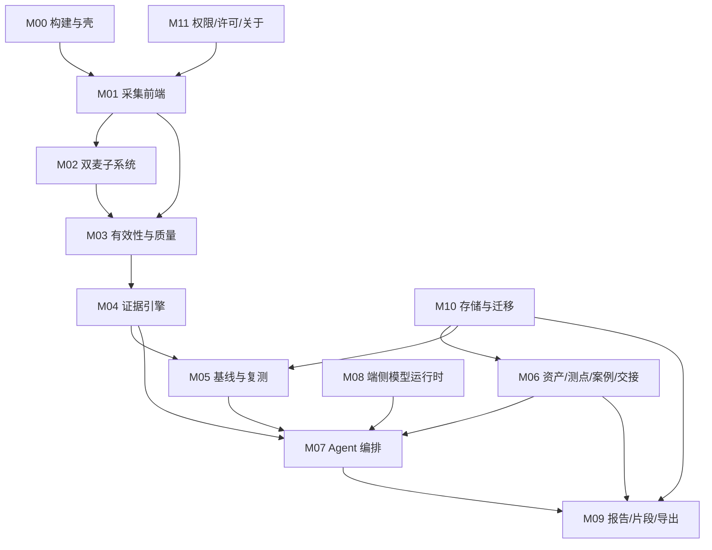

# 06 · 听诊仪开发需求文档（DRD）

> 本文是开发的单一入口。产品为什么这么做，见 01/02；Agent 契约见 03；提示词见 04；资产与工作量见 05。
> 本文只回答：**做什么、分几个模块、每个模块的接口与失败语义、数据怎么存、怎么验、怎么发。**

## 0. 结论先行（10 条）

1. **v1.0 范围**：手机自带麦克风（单麦 + 有条件双麦）、纯本地、离线闭环、报告可复核、汽蚀/堵塞两类故障名（逐类放行）、原始音频默认不留存。[F]
2. **双麦不是“第二个通道一开就有用”**：必须先探测（立体声支持 / 是否复制通道 / 是否被 NS/AGC/HPF 处理 / 通道映射），探测失败即单麦模式，方向项隐藏。[F]
3. **双麦只承诺三件事**：通道一致性、近场/远场粗判、直达声主导下的左右半平面（±30° 量级）；**不承诺角度精度、不承诺距离、不承诺源分离、不承诺跨通道幅度比较**。[F]
4. **端侧模型只做措辞与问答**，不产生任何物理量；3s 超时或数值不一致即回退规则/模板，回退路径必须独立通过同一批评测。[F]
5. **证据链分两级**：“可复核”（特征 + 原始帧渲染图 + 哈希 + 版本）与“可重算”（需要原始波形）；默认只保证前者，报告必须写明 `raw_available=false`。[F]
6. **数据模型一次到位**：IndexedDB 16 个 store，`schema_version` 与 `migration_id` 贯穿；旧 localStorage 一次性只读导入，不清空、不改写。[F]
7. **发布沿用 `com.luhuqiang.pumpnoise` 与既有证书**，versionCode 从 4 起递增到 5，应用名改「听诊仪」；覆盖安装必须保基线、案例、报告。[F]
8. **性能预算按中端机（骁龙 7 系 / 天玑 8000 级）**：冷启 ≤1.8s、采集首帧 ≤250ms、30s 数据判读 ≤3.5s（含模型）、报告 ≤3s。[I]
9. **验收 = GT 45 条自动化 + 现场 12 条**；任一 GT 红阻断合并，现场条缺证据不得宣称“真机验证完成”。[F]
10. **里程碑 15–19 周**；核心工程 75–105 人日，含 QA/试点/覆盖升级为 **88–122 人日**；不含真实故障样本采集标注。[I]

---

## 1. 决策基线（硬性输入，不再讨论）

| # | 决策 | 对开发的硬约束 | 落点 |
|-|-|-|-|
| D1 | 只用手机自带麦克风，不接外设；必须挖掘第二颗麦 | 无外接设备路径；双麦必须有探测与降级；不得把“双麦”写进宣传前提 | M02、§6 |
| D2 | 故障名只承诺汽蚀、堵塞 | 其余机制一律“疑似/需复测”；逐类开关；未过门模板固定 | M07、§3.8、03 §6 |
| D3 | 纯本地、无云端；允许端侧小模型，必须有规则/模板回退 | 无网络依赖；模型可缺省；回退语义等价；版本入报告 | M08、§7 |
| D4 | 原始音频默认不留存、不上传；只留特征与片段 | 默认 `retain_raw=false`；片段默认关；留存期与加密强制 | M09、§8 |
| D5 | 沿用旧包名与既有签名证书做升级 | applicationId 不变；versionCode 递增；迁移脚本必须有回滚点 | M00、§13 |

**变更记录**

| 版本 | 日期 | 变更 |
|-|-|-|
| 1.0 | 2026-11-03 | 首版；收口 D1–D5；新增双麦子系统、端侧模型、片段留存、覆盖升级四章 |

---

## 2. 范围与非目标

### 2.1 v1.0 范围（必须交付）

| 范围 | 内容 | 验收 |
|-|-|-|
| 现场会话 | 准备→认机/建档→测点→采集→判读→复测→报告→归档/交接 | 一台泵 15min 内完成；断网可用 |
| 采集 | 48k/16bit/PCM；单通道；有条件双通道 | 六类 invalid 100% 命中 |
| 质量三态 | `ok / low_confidence / invalid` | invalid 时方向输出 0 条 |
| 证据 | 1/3oct、轴频/阶次、包络重复率、事件轨、基线/复测 | 每个数可指回工具+参数+版本 |
| 判读 | 机制家族 + 支持/反证 + 一个验证实验 | 不出现未放行故障名 |
| 双麦 | 探测、标定、一致性、粗方向、降级 | 探测失败 → 单麦模式 |
| 报告 | 一页纸 + 附录 + manifest + 哈希 | 8 项元数据 100% |
| 存储 | IndexedDB + 导出/导入 + 迁移 | 覆盖升级不丢基线 |
| 发布 | 静态构建 + APK 壳 + 签名 + 自检 | check:apk ok=true |
| 端侧模型 | 可选加载；超时/异常回退模板 | 回退输出通过评测 |

### 2.2 非目标（v1.0 明确不做）

| 非目标 | 原因 |
|-|-|
| 外接麦克风/校准声级计/多通道阵列 | D1；无 BOM、无标定流程 |
| 绝对 SPL 或“dB”读数 | 未校准；跨机误差 >±5dB |
| 单麦/双麦源分离、精细定位、仰角、距离估计 | 物理欠定；双麦仅半平面 |
| 跨通道幅度比较、跨通道 SPL 推算 | 两麦频响/增益不同 |
| 汽蚀、堵塞以外的故障名 | D2；无标注放行 |
| 24h 在线监测/告警/推送/健康分 | 与现场诊断范式冲突 |
| 云端账号、云同步、云推理 | D3 |
| 原始音频默认留存/上传 | D4 |
| RUL、早期微裂纹、拆检指导 | 无模型/无真值/安全边界 |
| 新包名或新签名证书 | D5；破坏覆盖升级 |

---

## 3. 模块划分与依赖

### 3.1 模块清单

| 模块 | 名称 | 职责 | 复用来源 | 人日 |
|-|-|-|-|-|
| M00 | 构建与壳 | 静态 Vite 构建、WebView 壳、签名、发布自检 | 旧 APK 壳 + check:apk | 6–8 |
| M01 | 采集前端 | AudioRecord/Worklet、缓冲、双通道取数、掉帧检测 | `capture`/`meter` | 5–7 |
| M02 | 双麦子系统 | 能力探测、通道映射、标定、GCC-PHAT 粗方向、降级 | 新增 | 7–10 |
| M03 | 有效性与质量 | 削顶/AGC/采样率/掉帧/静音/非稳态；三态 | `validity.ts` | 3–4 |
| M04 | 证据引擎 | 谱/1-3oct/阶次/包络/事件轨 | `fft/bands/features/shaft-tracker/envelope/event-rail` | 6–8 |
| M05 | 基线与复测 | 基线、冻结门、可比性、delta | `fingerprint.ts` + 新增 | 5–7 |
| M06 | 资产/测点/案例/交接 | 实体、几何、案例库、交接包 | QR/settings + 新增 | 8–11 |
| M07 | Agent 编排 | 工具调度、门控、三态、拒答、状态机 | `diagnose/status-priority` 改造 | 10–14 |
| M08 | 端侧模型运行时 | 模型加载、推理、超时、数值校验、回退 | 新增 | 6–9 |
| M09 | 报告/片段/导出 | 报告 2.0、片段容器、导出包 | `report.ts` 升级 | 6–8 |
| M10 | 存储与迁移 | IndexedDB、schema、导入导出、旧数据迁移 | 新增 | 5–7 |
| M11 | 权限/许可/关于 | 麦克风/相机权限、可选授权、关于页 | `license.ts` 降级 | 3–5 |
| QA | 测试与现场 | GT 45 + 现场 12 + 真机矩阵 | `golden.test.ts` 扩展 | 8–12 |

### 3.2 依赖图



### 3.3 全局契约（所有模块必须遵守）

1. **纯函数优先**：DSP 不读全局、不写存储、不依赖 UI；输入同 → 输出同（浮点容差 1e-9）。
2. **数值只来自工具**：Agent/模型不得计算、外推、四舍五入改写物理量。
3. **错误结构化**：不抛裸异常；统一 `ToolError`（03 §8.5）。
4. **每份输出带 provenance**：`algorithm_version + params_hash + captured_at`。
5. **单位固定**：声级 `dBFS`；频率 `Hz`；时间 `s`；距离 `m`；角度 `deg`。UI 不出现 `dB SPL`。
6. **确定性**：判据/门控/拒答不得有随机；模型输出必须可被规则覆盖。

---

## 4. 模块规格（职责 / 接口 / 参数 / 失败语义）

### 4.1 M00 构建与壳

| 项 | 规格 |
|-|-|
| 职责 | 静态 Vite 构建；WebView 壳加载 `appassets.local`；签名、对齐、自检、发布事实卡 |
| 输入 | `npm run build` 产物；`apktool.yml`；keystore（受控环境，见内部交底 04） |
| 输出 | 签名 APK；`release-card.json`（build/versionCode/versionName/包哈希/内容指纹/证书哈希） |
| 关键参数 | minSdk 24、targetSdk 35、v1 关、v2/v3 开；assets 每次 `rm -rf` 后重拷；`index.html` 由构建直接产出 |
| 失败语义 | `E_BUILD_NO_INDEX`（无 index.html）→ 阻断；`E_APK_BROKEN_REF` → 阻断；`E_SIGN_VERIFY` → 阻断；`E_ASSETS_STALE`（存在旧 hash）→ 阻断 |
| 验收 | `check:apk` ok=true；同证书覆盖 Build 4 → 5 成功；`release-card.json` 四元组齐全 |

### 4.2 M01 采集前端

| 项 | 规格 |
|-|-|
| 职责 | 打开录音、拉流、分块送 DSP、双通道取数、掉帧/时钟监测 |
| 接口 | `capture.start(opts) → CaptureHandle`；`capture.stop() → CaptureSummary`；`capture.onBlock(cb)` |
| 输入 | `sample_rate_target=48000`；`channel_mode=auto|mono|stereo`；`source=mic|camcorder|voice_recognition`；`duration_s` |
| 输出 | 16bit PCM 块（mono 或 interleaved stereo）；`sample_rate_true`；`blocks`；`dropped`；`gap_ms_max`；`raw_hash` |
| 关键参数 | 块 128–1024 帧；`AudioRecord` buffer ≥ 2×最小；禁 `VOICE_COMMUNICATION`（AEC/NS/AGC）；48k ±1Hz；44.1k 走重采样路径 |
| 失败语义 | `E_PERMISSION_DENIED`、`E_MIC_BUSY`、`E_MIC_LOST`、`E_STEREO_UNSUPPORTED`、`E_SOURCE_REJECTED`、`E_TOO_SHORT`、`E_STORAGE_FULL` |
| 验收 | 真机 6 机型连续 120s 无掉帧；切后台/来电/IP 通话中断可检测；采样率真值写入 capture |

### 4.3 M02 双麦子系统（详见 §6）

| 项 | 规格 |
|-|-|
| 职责 | 探测立体声与通道独立性、映射通道、标定间距/固定偏移、GCC-PHAT 粗方向、输出降级原因 |
| 接口 | `probe() → StereoCapability`；`calibrate(procedure) → Calibration`；`doa(capture) → CoarseDOA` |
| 输出 | `mode(dual|mono_fallback)`、`channels[]`、`d_eff_m`、`calibration_state`、`side(left|right|front|unknown)`、`confidence_reasons[]` |
| 关键参数 | 间距 0.10–0.15m；τ_max 14–21 samples；空间 alias ≤1.1kHz；GCC-PHAT 200–1200Hz；峰突出 ≥6dB；相干 ≥0.6；τ 稳定 σ≤0.5 sample |
| 失败语义 | `E_STEREO_UNSUPPORTED`、`E_CHANNELS_DUPLICATED`、`E_CHANNEL_AGC`、`E_CHANNEL_HPF`、`E_CALIBRATION_REQUIRED`、`E_DIRECT_PATH_WEAK` |
| 验收 | GT31–GT39 全过；探测结论写入设备档案；单麦模式 UI 明示 |

### 4.4 M03 有效性与质量

| 项 | 规格 |
|-|-|
| 职责 | 六类硬门 + 非稳态 + SNR；输出三态与原因；双通道逐路判定 |
| 接口 | `quality.evaluate(capture_id) → Quality` |
| 输出 | `state`、`reasons[]`、`metrics{sample_rate_true,snr_db,clip,agc,dropped,silence,steady,channel_flags}` |
| 关键参数 | 削顶：连续 ≥3 点 ≥0.95；AGC：1.8/0.7/1.2/8s；掉帧 >2 或 gap>1.4s；静音 <−70dBFS；SNR 展示 24/25dB、判据 10dB；启停 5s 不出结论 |
| 失败语义 | `E_CAPTURE_NOT_FOUND`；内部不抛错，全部转 `reasons` |
| 验收 | GT01–GT05、GT31–GT34；invalid 时下游工具可算但不得出结论 |

### 4.5 M04 证据引擎

| 项 | 规格 |
|-|-|
| 职责 | 1/3oct、峰、SNR；1×–5× 谐波、轴频、亚谐波；包络重复率；4096 点事件轨 |
| 接口 | `spectrum.compute` / `orders.track` / `envelope.compute` / `events.detect`（签名见 03 §5） |
| 关键参数 | FFT 32768（0.6827s，Δf 1.4648Hz，ENBW 2.20Hz）；8192 仅预览；46Hz 1% 边带需 T≥2.2s；事件 4096=85.33ms；rpm≥900 且 ≥20 转；σ≤0.3Hz@46Hz；5% 主判据 + 3σ；线 SNR≥10dB；亚谐波>55% 判转速不确定 |
| 失败语义 | `E_CAPTURE_INVALID`、`E_FFT_UNSUPPORTED`、`E_RPM_REQUIRED`；软失败 `E_ORDERS_UNRELIABLE`、`E_BAND_EMPTY`、`E_GEOMETRY_MISSING` |
| 验收 | golden 20 条 + 新增 8 条；FFT 32768 单次 ≤120ms（中端机） |

### 4.6 M05 基线与复测

| 项 | 规格 |
|-|-|
| 职责 | 20 维基线、工况分档、冻结门限、可比性、delta |
| 接口 | `baseline.build/compare`；`gate.freeze`；`retest.compare` |
| 关键参数 | ≥30 帧且 ≥3 工况档；90d/500h 老化；维修删基线；不自动更新；冻结 ≥200 帧；`crestGateZ=3.5` 与 `eventZ` 分开；`score=100(1−e^(−d/2.2))` 非概率；回访 Δ≤1.5dB |
| 失败语义 | `E_BASELINE_INSUFFICIENT`、`E_BASELINE_STALE`、`E_GATE_UNFROZEN`、`E_INCOMPARABLE` |
| 验收 | GT10、GT11、GT13、GT14、GT28、GT29、GT30 |

### 4.7 M06 资产/测点/案例/交接

| 项 | 规格 |
|-|-|
| 职责 | 资产建档（QR/铭牌/手输）、测点几何与照片、案例入库、交接包 |
| 接口 | `asset.resolve`、`point.define`、`case.archive`、`handover.pack` |
| 关键参数 | 距离默认 0.30m，允许 0.20–0.50m；几何 4 项（距离/高度/朝向/照片）；`baselineKey` 由 asset+point+geometry_hash+条件档组成；交接摘要 ≤8 行 |
| 失败语义 | `E_ASSET_NOT_FOUND`、`E_ASSET_AMBIGUOUS`、`E_GEOMETRY_INCOMPLETE`、`E_CONSENT_REQUIRED`、`E_CASE_INCOMPLETE` |
| 验收 | 扫码→建档 ≤90s；接班 10min 内复现；案例导出/导入可回滚 |

### 4.8 M07 Agent 编排

| 项 | 规格 |
|-|-|
| 职责 | 场景识别、前置检查、工具调度、三态、拒答、冲突、下一动作、报告/交接 |
| 接口 | `agent.handle(AgentRequest) → AgentDecision`（03 §8.1/8.3） |
| 关键参数 | 一次一个动作；修复循环 ≤3；证据循环 ≤2；冲突取低置信；invalid 隐藏方向；未放行故障名固定模板 |
| 失败语义 | 工具错误转 `ToolError`；模型违规 → 丢弃并回退；状态机不可达 → `E_STATE_INVALID` |
| 验收 | 50 条脚本；应拒答 ≥90%；高把握错误 0；禁止输出扫描 0 |

### 4.9 M08 端侧模型运行时（详见 §7）

| 项 | 规格 |
|-|-|
| 职责 | 模型装载/卸载、提示词组装、推理、超时、数值一致性校验、回退 |
| 接口 | `llm.available() → bool`；`llm.generate(prompt, schema) → string`；`llm.cancel()` |
| 关键参数 | 模型 ≤300MB；内存峰值 ≤600MB；上下文 1024；首 token ≤2s；总超时 3s；量化 Q4_0/Q4_K_M |
| 失败语义 | `E_MODEL_MISSING`、`E_MODEL_OOM`、`E_MODEL_TIMEOUT`、`E_MODEL_SCHEMA`、`E_MODEL_NUMBER_MISMATCH` → 全部回退模板 |
| 验收 | GT40、GT41；离线模板与模型输出在 30 条评测上语义一致率 ≥95% |

### 4.10 M09 报告/片段/导出（详见 §8/§9）

| 项 | 规格 |
|-|-|
| 职责 | 报告 2.0、片段容器、`.tzcase` 导出、PDF/MD/JSON |
| 接口 | `report.build(session_id)`；`clip.enable/export/purge`；`export.pack(case_id)` |
| 关键参数 | 8 项元数据缺一不出；PDF A4 一页 + 附录；证据 PNG ≤300KB/张；6s WAV=576KB；FLAC≈300KB；AES-256-GCM；留存 30 天 |
| 失败语义 | `E_MISSING_METADATA`、`E_NO_EVIDENCE`、`E_EXPORT_FAILED`、`E_CLIP_DISABLED`、`E_CLIP_EXPIRED`、`E_CLIP_CONFIRM_REQUIRED` |
| 验收 | 报告可独立回答“哪版算法/基线/门限/设备”；片段到期自动清除 |

### 4.11 M10 存储与迁移（详见 §5）

| 项 | 规格 |
|-|-|
| 职责 | IndexedDB 建库/索引/事务；schema 升级；旧 localStorage 导入；导出/导入 |
| 接口 | `db.open()`；`db.migrate(to)`；`legacy.import()`；`backup.export()` |
| 关键参数 | DB `ausculto`；version 1 起；升级前自动备份；旧键只读；迁移失败回滚 |
| 失败语义 | `E_DB_OPEN`、`E_DB_QUOTA`、`E_MIGRATION_FAILED`、`E_BACKUP_CORRUPT` |
| 验收 | GT44；旧基线/门限/案例 100% 可见；清缓存前有导出提醒 |

### 4.12 M11 权限/许可/关于

| 项 | 规格 |
|-|-|
| 职责 | 麦克风/相机权限、可选授权、关于页、联系入口 |
| 接口 | `perm.ensure(kind)`；`license.status()`；`about.render()` |
| 关键参数 | 麦克风仅采集时开启；相机仅扫码/拍照；授权默认关闭；关于页含 `luhuqiang@foxmail.com`、版本、隐私、许可、algorithm_version；发布四元组受控展示 |
| 失败语义 | `E_PERMISSION_DENIED`、`E_LICENSE_EXPIRED`（不阻断采集，只提示） |
| 验收 | 拒绝权限后可走“仅查看案例”；关于页信息完整；导出报告页脚含联系入口 |

---

## 5. IndexedDB 数据模型

### 5.1 库与版本

- DB 名：`ausculto`
- 版本：`1`（v1.0 首版）；后续每次加 store/索引 +1
- 事务：写操作按 `session_id` 聚合；报告生成只读
- 配额：默认请求 `navigator.storage.persist()`；容量上限 2GB；超 80% 提示导出

### 5.2 Store 定义

| Store | 主键 | 字段 | 索引 |
|-|-|-|-|
| `meta` | `key` | `schema_version, app_build, algorithm_version, installed_at, device_profile_id` | — |
| `sites` | `id` | `name, customer_hash, created_at` | `created_at` |
| `assets` | `id` | `site_id, model, serial_hash, rated_rpm, blades, poles, bearing_geom, qr, nameplate_photo_id, created_at` | `site_id`, `qr`, `serial_hash` |
| `points` | `id` | `asset_id, label, distance_m, height_m, orientation_deg, photo_id, background_ref, geometry_hash, placement_fp, created_at, updated_at` | `asset_id`, `geometry_hash` |
| `sessions` | `id` | `asset_id, point_id, mode, operator, shift, started_at, ended_at, state, protocol_version, app_build, trace_id` | `asset_id`, `started_at`, `mode`, `state` |
| `captures` | `id` | `session_id, condition_json, sample_rate_true, duration_s, channel_mode, channel_count, channel_map, agc_flags, clip_flags, raw_hash, raw_ref, features_ref, created_at` | `session_id`, `created_at` |
| `evidence` | `id` | `capture_id, type, params_hash, values_json, unit, tool_version, created_at` | `capture_id`, `type` |
| `baselines` | `id` | `point_id, condition_bucket, frames, created_at, gate_version, status, version, dims_json` | `point_id`, `status` |
| `gates` | `id` | `point_id, baseline_version, frozen_at, crest_gate_z, event_z, p95, frames, frozen_by` | `point_id` |
| `events` | `id` | `capture_id, ts_ms, crest, kurtosis, z_score, publishable, gate_id` | `capture_id`, `publishable` |
| `cases` | `id` | `session_id, asset_id, point_id, state, hypothesis_ids, next_action, labels_json, handover_ready, created_at` | `asset_id`, `created_at`, `state` |
| `reports` | `id` | `session_id, manifest_json, md_blob_id, pdf_blob_id, report_sha256, created_at` | `session_id`, `created_at` |
| `handovers` | `id` | `case_id, from_role, to_role, summary, open_items_json, next_actions_json, created_at` | `case_id`, `created_at` |
| `clips` | `id` | `capture_id, trigger, pre_s, post_s, codec, encrypted, sha256, byte_size, expires_at, exported_at, export_reason` | `capture_id`, `expires_at` |
| `settings` | `key` | `value_json, updated_at` | `updated_at` |
| `migrations` | `id` | `from_version, to_version, applied_at, note, backup_ref` | `applied_at` |

> 共 16 个 store（含 `meta`/`settings`/`migrations`）。字段名固定，禁止同义改写。

### 5.3 迁移路径（v0 → v1 → 后续）

| 步骤 | 动作 | 失败处理 |
|-|-|-|
| 1 | 打开 DB；若不存在则建库并写 `meta.schema_version=1` | `E_DB_OPEN` → 提示重启 |
| 2 | 若 `versionchange`：先导出 `backup-<ts>.json` 到本地 | `E_DB_QUOTA` → 阻断升级 |
| 3 | 按 `migrations` 顺序执行脚本（纯函数，可重入） | 失败 → 回滚到备份并标记 `migration_failed` |
| 4 | 一次性读取旧 localStorage 六类键（设置/基线/事件/背景/授权/预设） | 缺键 → 跳过，不报错 |
| 5 | 映射旧设备→`assets`、旧基线→`baselines`（缺几何标 `unverified`） | 单条失败 → 记入 `legacy_import_errors`，不阻断整体 |
| 6 | 写 `meta.legacy_imported_at`；旧键保持只读，不清空 | — |
| 7 | 记录 `migrations` 一行，报告与关于页可查 | — |

**规则**

- 旧 localStorage 只读：不改写、不删除；新写入全部进 IndexedDB。
- 旧基线缺几何 → `status=unverified`，不参与趋势/复测。
- 迁移只做一次；重复启动检测 `legacy_imported_at` 直接跳过。
- 导出包 schema 与库同版；导入旧版包时先升级再合并。

---

## 6. 双麦子系统（专项）

### 6.1 物理边界（先写死，代码不得越过）

| 项 | 值/公式 | 含义 |
|-|-|-|
| 声速 | `c ≈ 331.6 + 0.6·T(°C)`；20°C ≈ 343.6 m/s | 温度修正 0.17%/°C，粗方向可忽略 |
| 1 sample @48k | `20.833 µs` | 路径差 `≈7.15 mm` |
| 间距 | `d = 0.10–0.15 m`（典型 0.12） | τ_max = `d/c` = 0.291–0.437ms = 14.0–21.0 samples |
| 空间 alias | `f ≤ c/(2d)`；d=0.12 → **1430 Hz**；d=0.10 → 1715Hz；d=0.15 → 1143Hz | 高于此相位模糊，禁止用于方向 |
| 工作频带 | **200–1200 Hz** | 留 20% 余量，避开 HPF 与 alias |
| 理论角度 | `τ = (d/c)·cosθ`（端射几何） | 仅反解半平面，不解仰角 |
| 亚采样 | 抛物线插值峰；目标 0.1 sample ≈0.72mm | 相位斜率法可到 0.05 sample（高 SNR） |

### 6.2 能力探测（必须全过才启用双麦）

| # | 探测项 | 方法 | 判定 | 失败结果 |
|-|-|-|-|-|
| P1 | API 支持 | 依次尝试 `MIC/CAMCORDER/VOICE_RECOGNITION` + `CHANNEL_IN_STEREO` @48k | 任一成功 → 候选 | `E_STEREO_UNSUPPORTED` → mono |
| P2 | 真实通道数 | 读 buffer 长度/`channelCount` | =2 且非交错错误 | mono |
| P3 | 复制通道 | lag=0 归一化互相关 `r0`；残差能量 `10log10(Σ(x1−x2)²/Σx1²)` | `r0≥0.995` 且残差 `≤−40dB` → 复制 | `E_CHANNELS_DUPLICATED` → mono |
| P4 | 通道映射 | 遮住底部麦 3s（或顶部麦），看哪一路下降 | 下降 ≥10dB 的为被遮通道 | 两路同降 → 共用端口 → mono |
| P5 | 独立噪声 | 静音 5s，比较两路 RMS 与差值 RMS | 差值 <−35dB → 复制/共用 | mono |
| P6 | 逐路 AGC | 复用 C15 检测（1.8/0.7/1.2/8s） | 任一路触发 → 该路 `agc=true` | 两路 AGC → 方向禁用 |
| P7 | 逐路 HPF | 同一采集比较 50/63/80Hz 与 200Hz 的 1/3oct 能差 | 顶部麦低 3 带 ≥8dB → `hpf=true` | 工作带下沿抬到 200Hz；仍不足 → 方向禁用 |
| P8 | 位深/采样率 | `AudioFormat.ENCODING_PCM_16BIT`；`getSampleRate()` | 16bit；48k ±1Hz 优先 | 44.1k → 重采样 + invalid 阶次 |
| P9 | 固定时延 | 正前方 0° 拍手 3 次，GCC 峰中位数 | `|τ0|≤0.5 sample` 视为已对齐 | 否则写入 `τ0` 供运行时扣除 |
| P10 | 系统处理 | 相干性 + 谱形突变 + AGC 事件 | 相干 <0.3 或谱形跳变 → `processed=true` | 方向禁用，仅做一致性 |

> 探测结果写入 `device_profile`（按 `Build.MODEL + Build.ID + app_build` 建键），同一机型不重复探测；系统升级后强制重探。

### 6.3 几何自标定（一次性，写入设备档案）

**目的**：未知间距 `d` 与固定偏移 `τ0` 的联合标定；没有标定不得输出方向。

**步骤（现场 90 秒）**

1. 选安静角落（本底 ≤45dB(A)），手机横持，两麦连线水平。
2. 声源（拍手/钥匙串）在正前方 0.5m、与两麦连线成 **+45°**，连续 3 次，每次间隔 ≥1s；录 5s。
3. 同法在 **−45°** 重复 3 次。
4. 每次取 GCC-PHAT 峰（200–1200Hz），抛物线插值到 0.1 sample；取 3 次中位数 `τ_L`、`τ_R`。
5. 计算：`d_eff = c·(|τ_L| + |τ_R|) / (2·cos45°)`；`τ0 = (τ_L + τ_R)/2`（带符号，左正右负约定）。
6. 写入 `calibration{d_eff_m, tau0_samples, c_m_s, temp_c, method=clap_45, residuals_pct, state}`。

**验收判据**

| 项 | 通过 | 不通过 |
|-|-|-|
| `d_eff` | 0.08–0.18m 且与机型先验 0.12m 差 ≤0.03m | `state=unverified`，隐藏方向 |
| 残差 | 6 次拟合相对残差 ≤15% | 重标一次；仍失败 → unverified |
| `τ0` | ≤0.5 sample | 重标；仍失败 → 方向禁用 |
| 复标触发 | OS 大版本升级、换机、探测 P4 映射变化 | 提示“请重新标定” |

> 标定不是“精度承诺”：即使 `verified`，方向也只输出半平面 ±30°，不输出角度值。

### 6.4 粗方向（GCC-PHAT）

**输入**：双通道 48k、同一 capture、≥0.68s 稳态窗、`calibration.state=verified`。

**处理**

1. 去均值、Hann 窗、32768 点 FFT（0.6827s）。
2. 互谱 `G12 = X1·conj(X2)`；PHAT 加权 `G12/|G12|`；带内 200–1200Hz，带外置 0。
3. IFFT 得互相关；在 `±(d_eff/c)·fs + 2` 范围内找峰；抛物线插值得 `τ`。
4. 5 帧（50% 重叠）取中位数 `τ_med`，计算 `σ_τ`。
5. 扣除 `τ0`；`side = left if τ_med>+2 samples; right if <−2; front if |τ|≤2`。

**放行条件（全部满足才输出方向）**

| 条件 | 阈值 | 不满足 |
|-|-|-|
| 峰突出 | 峰值 / 次峰（±2 sample 外）≥ 6dB | `unknown` |
| 带内相干 | `γ²(200–1200Hz) ≥ 0.6` | `unknown` |
| 帧间稳定 | `σ_τ ≤ 0.5 sample` | `unknown` |
| 直达声主导 | 峰在 `|τ|≤d_eff/c` 内且无早于峰的强反射 | `unknown` |
| 标定 | `verified` | `unknown` + “未标定” |
| 质量 | 两路均无削顶/AGC/掉帧 | `unknown` |

**输出语义**

- 只说：`声源偏左 / 偏右 / 正前（±30° 量级）`。
- 不说：具体角度、距离、高度、哪台设备、哪个部件。
- 反向证据：`side` 与“手持手机朝向”绑定；报告必须记录手机朝向与测点。

### 6.5 明确不可承诺（写入 UI 与提示词）

| 不可承诺 | 原因 |
|-|-|
| 精细角度（±5°/±10°） | 间距小、SNR/混响限制；τ 误差 0.1 sample ≈4° 理论但现场远达不到 |
| 仰角/三维方向 | 两麦共线，只有一维 |
| 距离/近场精确边界 | 需声源强度与传递；只能粗判 |
| 跨通道幅度比较/SPL | 两麦频响与增益不同 |
| 源分离 | 单方程多源，仍欠定 |
| 混响环境方向 | 反射破坏 TDOA |
| f>1.2kHz 的方向 | 相位模糊 |

### 6.6 近场/远场粗判（可承诺的最小版本）

- 用双通道**相干性随频率下降**与**通道间幅度差**（只作定性，不作定量）辅助：
  - `γ²(1–4kHz) ≥0.8` 且两路电平差 <3dB → “近场/直达声较强”；
  - `γ²` 快速下降且电平差 >6dB → “反射/远场为主”，方向与阶次结论降级。
- 该判断只进 `quality.reasons`，不单独作为结论；不输出距离数值。
- 单麦模式无此项。

### 6.7 降级链（必须实现）

```
stereo probe
  ├─ 失败 → mono_fallback（UI 标注“单麦模式”）
  ├─ 复制/共用 → mono_fallback（原因：channels_duplicated）
  ├─ 单路 AGC/削顶 → 该路剔除；若主路可用 → mono_fallback（原因：channel_degraded）
  ├─ HPF → 工作带 200–1200Hz；带内无能量 → 方向 unknown
  ├─ 未标定/标定失败 → 采集与证据正常；方向 unknown + “未标定”
  └─ 全通过 → dual；方向按 §6.4 放行
```

**UI 规则**

- 单麦模式：采集页顶部常驻 `单麦模式 · 无方向`；判读卡不出现方向卡；报告“限制”首条写单麦。
- 双麦但方向 unknown：显示“方向不可判（原因）”，不显示灰卡。
- 任何情况下不得用双麦提升“故障名”置信；故障名放行仍按 03 §6。

---

## 7. 端侧模型集成（决策 3）

### 7.1 定位

| 项 | 规定 |
|-|-|
| 能做 | 把结构化证据转成现场话术；解释名词；多轮问答；报告叙述润色 |
| 不能做 | 生成/修改任何数值；新增证据；改变三态；输出故障名/SPL/定位/RUL |
| 默认 | **关闭**；设置页显式开启；“仅本地，不联网”常驻说明 |
| 回退 | 规则 + 模板始终可用；模型失败无感降级，结论不变 |

### 7.2 容量与性能预算

| 项 | 预算 | 超限处理 |
|-|-|-|
| 模型文件 | ≤300MB（0.5B 级，Q4_0/Q4_K_M GGUF） | 不加载，提示“空间不足” |
| 运行时 | llama.cpp JNI（GGUF）；或 ONNX Runtime Mobile（分类器） | 缺库 → 模板 |
| 内存峰值 | ≤600MB（模型+KV cache）；整机峰值 ≤850MB | `E_MODEL_OOM` → 立即卸载 |
| 上下文 | ≤1024 tokens | 截断证据，不截断约束 |
| 首 token | ≤2.0s（中端机，prefill ≤256 tokens） | 超时 → 模板 |
| 总超时 | **3.0s** 硬超时（含首 token） | `E_MODEL_TIMEOUT` → 模板 |
| 解码速度 | ≥8 tok/s | 低于 5 tok/s 自动关闭 |
| 存储 | 模型可选下载/侧载；不随 APK 打包（控制包体） | 未安装 → 模板 |
| 温控 | 连续 3 次超时或机身过热 → 本次会话禁用模型 | 会话级熔断 |

### 7.3 调用契约

```json
{
  "task": "rephrase_decision",
  "prompt_version": "P0-1.0",
  "rule_version": "R-1.0",
  "model_id": "qwen2.5-0.5b-instruct-q4_0",
  "model_sha256": "<hash>",
  "input": {"decision": {}, "evidence": {}},
  "constraints": {"max_chars": 240, "no_new_numbers": true, "locale": "zh-CN"},
  "timeout_ms": 3000
}
```

**返回后校验（缺一即丢弃）**

1. JSON Schema 通过（03 §8.3）。
2. **数值一致性**：模型输出中出现的每个数字，必须能在 `EvidenceBundle` 中找到同值；否则 `E_MODEL_NUMBER_MISMATCH`。
3. 禁止词扫描：`dB SPL`、未放行故障名、`定位`、`源分离`、`RUL`、`准确率/概率`。
4. 三态一致：模型不得把 `invalid` 说成“正常/未见异常”。
5. 长度 ≤240 字（判读卡）/ ≤800 字（报告段落）。

### 7.4 版本与可复现

报告 manifest 必写：

| 字段 | 说明 |
|-|-|
| `model_id` / `model_sha256` / `quant` | 模型身份 |
| `runtime` / `runtime_version` | llama.cpp/ORT 版本 |
| `prompt_version` | 提示词版本 |
| `rule_version` | 规则/模板版本 |
| `used_model` | true/false；false 时写 `fallback_reason` |

> 同会话重算时，若模型版本不同，报告标 `recomputed_with_different_model=true`，不得静默覆盖。

### 7.5 评测（离线可跑）

- 30 条固定输入（覆盖 ok/low/invalid、单麦/双麦、汽蚀/堵塞疑似）。
- 指标：Schema 通过率 100%；数值一致率 100%；禁止词 0；与模板语义一致率 ≥95%；P95 延迟 ≤3s。
- 任一不达标 → 模型默认关闭，只发模板版。

---

## 8. 原始音频与片段（决策 4）

### 8.1 默认策略

| 项 | 默认 | 可选 |
|-|-|-|
| 原始音频留存 | **关** | 用户显式开启，按案例 |
| 上传 | **永不** | 无云计划；导出由用户手动 |
| 特征留存 | 开 | 不可关（报告需要） |
| 片段留存 | 关 | 开 → 仅触发前后各 3s |
| 留存期 | 30 天 | 7/30/90 天 |
| 加密 | 开（AES-256-GCM） | 不可关 |

### 8.2 片段定义

| 项 | 规格 |
|-|-|
| 触发 | 事件轨命中、判读为 `low_confidence` 需人工听、用户手动标记 |
| 长度 | 前 3s（环形缓冲）+ 后 3s = 6s |
| 格式 | 48k/16bit/mono WAV（证据级）；FLAC（无损压缩，推荐，≈300KB）；AAC 64kbps 仅“试听副本”，标 `non_evidentiary=true` |
| 大小 | 6s WAV = 576,000 字节；FLAC ≈300KB |
| 容器 | 扩展 `.tzclip`：magic `TZC1` + version + nonce + ciphertext + sha256 |
| 加密 | AES-256-GCM；密钥存 Android Keystore，不落盘、不进备份 |
| 留存 | `expires_at = created_at + retention_days`；启动/每日清理 |
| 导出 | 二次确认 + 填写原因 + 记 `exported_at/export_reason`；导出包内明确“含原始音频，可能含人声” |
| 禁止 | 后台自动录制；通话/会议环境自动留存；上传 |

### 8.3 特征保留字段（报告可复核的最小集）

| 类别 | 字段 |
|-|-|
| 采集 | `sample_rate_true, duration_s, channel_mode, channel_count, channel_map, dropped_blocks, gap_ms_max` |
| 电平 | `rms_dbfs, peak_dbfs, crest_factor, kurtosis, clip_count, agc_events, silence_ratio` |
| 谱 | 1/3oct 40Hz–10kHz 带级（dBFS）；`snr_db`；`resolution{df_hz, enbw_hz, window_s}` |
| 阶次 | `f0_hz, sigma_hz, revs, line_snr_db, harmonic_1x..5x`（幅值/相位可选）、`subharmonic_ratio` |
| 包络 | `repetition_hz[]`、峰突出度、带通 1500–6000Hz |
| 事件 | `ts_ms, crest, kurtosis, z_score, publishable` |
| 双麦 | `mode, d_eff_m, tau0_samples, side, coherence, peak_prominence_db, calibration_state` |
| 质量 | `state, reasons[]` |
| 版本 | `algorithm_version, gate_version, protocol_version, app_build, device_profile_id` |

> 不保留：原始波形（默认）、复数谱、未压缩中间缓冲。

### 8.4 证据强度声明（报告固定段）

- **可复核**：报告含原始帧渲染 PNG、特征值、参数、哈希、版本；他人可核对同一图与同一数。
- **可重算**：只有保留原始音频时才成立；默认 `raw_available=false`，报告必须写明“无法从原始波形重算 FFT”。
- **可复现**：同点、同几何、同工况、同版本重测，比较 1/3oct；不等价于“重算”。
- 禁止把“可复核”写成“可复现原始数据”。

---

## 9. 报告与导出

### 9.1 报告结构

| 段 | 内容 | 必填 |
|-|-|-|
| 0 首页 | 三态、一句话、关注级别、下一动作、限制 | 是 |
| 1 设备/测点 | 型号/序列哈希/转速/叶片/极数；距离/高度/朝向/照片 | 是 |
| 2 工况/质量 | 三工况、采样率真值、AGC/削顶/掉帧、SNR、阶次可用 | 是 |
| 3 证据 | 1/3oct、阶次、包络、事件、基线/复测；参数+版本 | 是 |
| 4 机制 | 候选机制、支持、反证、验证实验；不写故障名 | 是 |
| 5 复测 | 可比性、delta、结论 | 有则必填 |
| 6 双麦 | 模式、方向（若放行）、标定状态、不可承诺声明 | 是 |
| 7 限制 | 单麦/未校准/无定位/无 RUL/非计量/片段策略 | 是 |
| 8 交接 | 未决、下一班动作、安全 | 是 |
| 9 manifest | 8 项 + 哈希 + 版本 + 模型/提示词/规则版本 | 是 |

### 9.2 导出格式

| 格式 | 用途 | 说明 |
|-|-|-|
| PDF | 打印/客户 | A4 一页 + 附录；字体嵌入；页脚联系入口 |
| Markdown | 归档/二次编辑 | 与 PDF 同源 |
| JSON | 复核/系统对接 | `ReportManifest` + 证据 |
| PNG | 证据图 | 原始帧渲染，非缩放截图 |
| `.tzcase` | 交接/备份 | zip：manifest + report + evidence + features + clip(可选) |

### 9.3 导出流程

1. 校验 8 项元数据 → 缺项 `E_MISSING_METADATA`，只能存草稿。
2. 生成 PDF 与哈希；写 `reports`。
3. 若含片段：二次确认 → 解密 → 打包 → 记录原因。
4. 导出完成提示“已生成，含/不含原始音频”。

---

## 10. 错误码表

| 码 | 模块 | 可重试 | 用户文案 | 处理 |
|-|-|-|-|-|
| `E_PERMISSION_DENIED` | M01 | 是 | 未授权麦克风，无法采集 | 跳系统设置 |
| `E_MIC_BUSY` | M01 | 是 | 麦克风被占用 | 关闭其他录音后重试 |
| `E_MIC_LOST` | M01 | 是 | 设备断开，本次草稿 | 保留已采块 |
| `E_STEREO_UNSUPPORTED` | M02 | 否 | 本机不支持双通道 | 单麦模式 |
| `E_CHANNELS_DUPLICATED` | M02 | 否 | 双通道为复制信号 | 单麦模式 |
| `E_CHANNEL_AGC` | M02 | 是 | 某一路自动增益介入 | 该路剔除/单麦 |
| `E_CHANNEL_HPF` | M02 | 否 | 顶部麦被高通处理 | 抬工作带/禁方向 |
| `E_CALIBRATION_REQUIRED` | M02 | 是 | 未标定，方向不可用 | 引导 90s 标定 |
| `E_DIRECT_PATH_WEAK` | M02 | 是 | 反射过强，方向不可判 | 换点/近场 |
| `E_SAMPLE_RATE` | M03 | 是 | 设备仅支持 44.1k | 重启≤3→重采样→invalid |
| `E_CLIP` | M03 | 是 | 削顶，本次不可判读 | 退距/降增益 |
| `E_AGC` | M03 | 是 | 自动增益介入 | 关闭增强/换机 |
| `E_DROPPED` | M03 | 是 | 音频中断 | 重采 |
| `E_SILENCE` | M03 | 是 | 没有信号 | 查权限/输入 |
| `E_NONSTEADY` | M03 | 是 | 工况未稳 | 等 10s |
| `E_ORDERS_UNRELIABLE` | M04 | 否 | 转速不足，不做阶次 | 只做形态 |
| `E_RPM_REQUIRED` | M04 | 是 | 缺额定转速 | 补录 |
| `E_BASELINE_INSUFFICIENT` | M05 | 是 | 基线不足 | 首次模式 |
| `E_GATE_UNFROZEN` | M05 | 是 | 门限未冻结 | 只记录 |
| `E_INCOMPARABLE` | M05 | 否 | 两次不可比 | 禁“变好/变坏” |
| `E_ASSET_AMBIGUOUS` | M06 | 是 | 找到多台设备 | 给候选不猜 |
| `E_GEOMETRY_INCOMPLETE` | M06 | 是 | 测点几何不完整 | 补 4 项 |
| `E_CONSENT_REQUIRED` | M06 | 否 | 未同意交接 | 拒生成 |
| `E_MODEL_MISSING` | M08 | 否 | 未安装本地模型 | 模板 |
| `E_MODEL_OOM` | M08 | 是 | 内存不足 | 卸载/模板 |
| `E_MODEL_TIMEOUT` | M08 | 是 | 推理超时 | 模板 |
| `E_MODEL_NUMBER_MISMATCH` | M08 | 否 | 输出数值不一致 | 丢弃+模板 |
| `E_MISSING_METADATA` | M09 | 是 | 报告缺项 | 存草稿 |
| `E_CLIP_DISABLED` | M09 | 否 | 片段未开启 | 不导出 |
| `E_CLIP_EXPIRED` | M09 | 否 | 片段已过期 | 不可恢复 |
| `E_CLIP_CONFIRM_REQUIRED` | M09 | 否 | 需二次确认 | 阻断导出 |
| `E_DB_QUOTA` | M10 | 是 | 存储不足 | 导出/清理 |
| `E_MIGRATION_FAILED` | M10 | 否 | 数据升级失败 | 回滚备份 |
| `E_UNSAFE_PERTURB` | M07 | 否 | 需人工安全确认 | 不执行 |
| `E_STATE_INVALID` | M07 | 是 | 会话状态异常 | 重置当前会话 |
| `E_BUILD_NO_INDEX` | M00 | 否 | 构建缺入口 | 阻断发布 |
| `E_APK_BROKEN_REF` | M00 | 否 | 包内引用缺失 | 阻断发布 |
| `E_SIGN_VERIFY` | M00 | 否 | 签名校验失败 | 阻断发布 |

---

## 11. 性能预算

> 基准机：中端 Android（骁龙 7 系 / 天玑 8000 级，8GB RAM，UFS）；低端机单列。`[I]` 需 M0 实测校准。

| 场景 | 预算 | 测量点 | 超限处理 |
|-|-|-|-|
| 冷启动 → 可交互 | ≤1.8s（低端 ≤3.0s） | 首帧绘制 | 首屏骨架；延后建库 |
| 打开麦克风 → 首帧 | ≤250ms | `capture.start` 到首块 | 提示“正在启动麦克风” |
| 30s 采集（3 工况） | 90s 内完成 | 含重采 | 不自动延长 |
| 单次 32768 FFT | ≤120ms | 中端机 | 降 16384 并标降级 |
| 30s 数据全证据链 | ≤1.5s | 3 工况合计 ≤4.5s | 进度条 + 可取消 |
| 判读（规则） | ≤50ms | `agent.handle` | — |
| 判读（含模型） | ≤3.5s | 含 3s 超时 | 回退模板 |
| 报告生成 | ≤2s | MD+JSON | 分步渲染 |
| PDF 导出 | ≤3s | 10 页内 | 后台任务 + 进度 |
| `.tzcase` 导出（10MB） | ≤5s | 含 zip | 后台 + 通知 |
| DB 查询 1000 案例 | ≤100ms | 索引命中 | 分页 |
| 内存峰值（无模型） | ≤300MB | 采集+32768 FFT | 降 FFT/清缓存 |
| 内存峰值（含模型） | ≤850MB | 模型+KV | 卸载模型 |
| 单次会话元数据 | ≤200KB | 不含片段/大图 | 压缩特征 |
| 每次证据 PNG | ≤300KB | 1080p 渲染 | 降采样 |
| 电量（10min 会话） | ≤5% | 4000mAh 基准 | 降刷新率 |

---

## 12. 验收用例

### 12.1 Golden Test（自动化，GT01–GT45）

| # | 场景 | 期望 |
|-|-|-|
| GT01 | 44.1k 设备 | 重启≤3→重采样→invalid→禁阶次 |
| GT02 | 连续 3 点 0.95 削顶 | invalid；事件不可发布 |
| GT03 | AGC 2dB/8s | invalid |
| GT04 | 掉 3 帧 / gap 1.5s | invalid |
| GT05 | 静音 −80dBFS | invalid |
| GT06 | 46Hz+5 谐波合成 | f0 误差 ≤0.3Hz；σ 打印 |
| GT07 | 23Hz 亚谐波 >55% | 转速不确定；禁阶次 |
| GT08 | 1500rpm（17 转） | 阶次不可用 |
| GT09 | 线 SNR 8dB | 阶次不可用 |
| GT10 | 基线 20 帧 | insufficient；无趋势 |
| GT11 | 门限 50 帧 | unfrozen；只记录 |
| GT12 | 维修事件 | 基线删除；旧报告保留 |
| GT13 | 两次几何不同 | 不可比；禁“变好/变坏” |
| GT14 | 无基线首次 | low_confidence；不做趋势 |
| GT15 | 请求 dB SPL | 拒答 `SPL_ABSOLUTE` |
| GT16 | 请求未放行故障名 | 拒答 `FAULT_NAME_NOT_RELEASED` |
| GT17 | 请求定位 | 拒答 `LOCALIZE_SOURCE` |
| GT18 | 请求 RUL | 拒答 `RUL` |
| GT19 | 并排机组未隔离 | 拒答 `PARALLEL_UNITS` |
| GT20 | 报告缺几何 | 不生成；草稿 |
| GT21 | 报告缺算法版本 | 不生成 |
| GT22 | 提示词输出百分比概率 | 违规扫描命中 |
| GT23 | low 被说成“正常” | 违规 |
| GT24 | 无网启动 | 模板可用 |
| GT25 | 存储满 | 不覆盖旧案例 |
| GT26 | 案例 hash 不匹配 | 隔离；不猜 |
| GT27 | 时钟漂移 10min | 标记；报告注明 |
| GT28 | 冻结 200 帧 | 可发布；打印 crestGateZ/eventZ |
| GT29 | 同点复测 1.6dB | 不可比 |
| GT30 | 同点复测 1.4dB | 可比 |
| GT31 | 立体声且独立 | `mode=dual`；通道映射正确 |
| GT32 | 两路复制（r0=0.999） | `mode=mono_fallback`；原因 `channels_duplicated` |
| GT33 | 仅副路削顶 | 主路可用→单麦；方向隐藏；`channel_flags` 记录 |
| GT34 | 副路 AGC | 该路剔除；方向 unknown；不跨通道比幅 |
| GT35 | 合成 0.12m、+45°、SNR 15dB | `side=left`；只输出半平面；无角度值 |
| GT36 | 2kHz 窄带源 | 方向 `unknown`（alias 拒答） |
| GT37 | RT60=0.8s 混响 | 相干 <0.6 → `unknown` |
| GT38 | 未标定 | `unknown` + “未标定”；采集正常 |
| GT39 | 副路 80Hz 以下 −12dB | `hpf=true`；工作带抬到 200Hz；带内可用则方向正常 |
| GT40 | 模型超时 3s | 模板输出；数值与证据逐一相同 |
| GT41 | 模型编造一个新数字 | `E_MODEL_NUMBER_MISMATCH`；丢弃 |
| GT42 | 片段到期 | 启动清理；`clips` 无残留；不可导出 |
| GT43 | 导出片段未二次确认 | 阻断 `E_CLIP_CONFIRM_REQUIRED` |
| GT44 | 旧 localStorage 六类键 | 100% 迁移；旧基线可见；旧键未改 |
| GT45 | Build4 → v2.0.0 覆盖安装 | 基线/案例/报告保留；versionCode 5 |

### 12.2 现场用例（F01–F12，每条留证据）

| # | 场景 | 步骤 | 通过判据 |
|-|-|-|-|
| F01 | 首次巡检 | 建档→3 工况→报告 | ≤15min；8 项齐全；无基线表述正确 |
| F02 | 复测 | 同点同工况再测 | ≤6min；可比；delta 可解释 |
| F03 | 汽蚀复现 | 阀门节流→复测 | 机制“流致/宽带”+ 验证实验；不命名故障（未放行） |
| F04 | 堵塞复现 | 出口阀/滤网 | 同上；不把 1× 变化误读为不平衡 |
| F05 | 维修后验收 | 修前基线→修后同协议 | 有修前基线才可“验收”；否则降级首次 |
| F06 | 跨班交接 | A 班生成交接包→B 班复现 | 10min 内复现≥80%；未决项完整 |
| F07 | 单麦机型 | 探测失败 | UI 明示单麦；方向卡不出现；报告限制首条 |
| F08 | 高背景噪声 | 75dB(A) 背景 | SNR<10 拒答；10–24 降级 |
| F09 | 44.1k 设备 | 采集 | invalid；提示明确；不产出阶次 |
| F10 | 并排机组 | 未隔离 | 拒答串扰；建议近场/隔声 |
| F11 | 飞行模式 | 全流程 | 采集→判读→报告→导出 100% |
| F12 | 戴手套单手 | 全流程 | 关键动作可完成；误触有确认 |

### 12.3 验收口径

- GT 全绿才可合并；任一红 → 阻断。
- 现场用例每条必须有：设备型号/OS、步骤、预期、实际、截图或录屏、结论。
- “真机验证完成”= 6 机型 × 六项采集 + 双麦 4 机型 + 覆盖升级 1 次，缺一不可。
- 报告指标：8 项 100%；哈希可复算；`raw_available` 与实际一致。

---

## 13. 打包、签名与发布（决策 5）

### 13.1 身份与版本

| 项 | 值 |
|-|-|
| applicationId | `com.luhuqiang.pumpnoise`（**不变**） |
| 应用名 | 听诊仪（launcher label 改，包名不改） |
| versionCode | Build 4 = 4 → v2.0.0 = **5**，之后每次 +1，禁止回退 |
| versionName | `2.0.0` 起；语义版本 |
| minSdk / targetSdk | 24 / 35 |
| 签名 | 沿用既有 keystore 与别名；v1 关、v2/v3 开；证书不变→可覆盖升级 |
| 密钥托管 | **见内部交底 04**；本文与代码库不含口令/证书指纹 |

> 改名说明：Android 的升级身份由 `applicationId + 签名证书` 决定，不由应用显示名决定；因此“改名听诊仪”不需要新包名，也不应换包名——换包名等于新产品，旧数据无法自动继承。

### 13.2 构建流程（静态化后）

```
npm ci
npm run typecheck
npm run build            # Vite 静态构建，直接产出 index.html
rm -rf .apkwork/monitor/assets/www
cp -a dist/. .apkwork/monitor/assets/www/
# 更新 apktool.yml versionCode/versionName
java -jar apktool.jar b .apkwork/monitor -o build-unaligned.apk
zipalign -f 4 build-unaligned.apk build-aligned.apk
apksigner sign --ks <受控路径> --v1-signing-enabled false --v2 true --v3 true ...
npm run check:apk -- build-signed.apk
node scripts/release-card.mjs     # 写 release-card.json
```

**与旧流程的差异**

| 旧 | 新 |
|-|-|
| SSR 产物无 index.html，需从 8081 抓 | 静态构建直接有 index.html |
| 依赖 TanStack Start/Nitro | Vite 单页 |
| 首次白屏风险高 | 构建期即可校验引用 |
| 无 assets diff | `check:apk` 增加 diff 与首屏 JS 冒烟 |

### 13.3 check:apk 增强项

| 检查 | 通过条件 |
|-|-|
| index.html 存在 | 是 |
| JS/CSS 引用 | 全部存在；`brokenRefs=[]` |
| manifest | 存在 |
| 版本 | versionCode/Name 与 apktool.yml 一致 |
| 签名 | v2/v3=true；证书与发布记录一致 |
| 内容指纹 | `contentSha256` 可复算 |
| assets diff | 与上一版清单比较，输出新增/删除/变更 |
| 首屏冒烟 | 无 pageerror；无首屏 JS 错误 |
| 事实卡 | `release-card.json` 四元组齐全 |

### 13.4 覆盖安装验证（必做，一次）

| 步 | 操作 | 期望 |
|-|-|-|
| 1 | 安装 Build 4（versionCode 4） | 启动正常 |
| 2 | 建 1 台资产、1 个测点、1 条基线、1 份报告 | 数据可见 |
| 3 | 覆盖安装 v2.0.0（versionCode 5，同证书） | 安装成功，不清数据 |
| 4 | 启动并查看 | 资产/测点/基线/报告全部可见；`migration_id` 有记录 |
| 5 | 采一次新会话 | 正常；旧基线可比较（若几何一致） |
| 6 | 导出 `.tzcase` | 含旧案例；`raw_available=false` 正确 |

### 13.5 发布门禁

1. typecheck 零错误；音频 golden 全绿。
2. GT01–GT45 全绿；现场 F01–F12 有证据。
3. `check:apk ok=true`；事实卡四元组齐全。
4. 同证书覆盖升级验证通过。
5. 双麦探测矩阵在 4 机型有记录；不支持机型明确降级。
6. 模型未安装/超时路径验证通过。
7. 未完成项写入发布说明，不得隐去。

---

## 14. 里程碑与排期

| 里程碑 | 周期 | 交付 | 退出条件 | 人日 |
|-|-|-|-|-|
| M0 基线 | 1.5–2 周 | git、静态构建、Schema 冻结、IndexedDB v1、发布流水线 | `check:apk` 绿；空壳可装 | 8–11 |
| M1 现场闭环 | 4–5 周 | 采集/质量/证据/会话七步/报告 2.0 | F01/F02/F11 通过 | 26–35 |
| M2 双麦 | 2–3 周 | 探测/标定/GCC-PHAT/降级/UI | GT31–GT39 + 4 机型 | 7–10 |
| M3 规则 Agent | 2–3 周 | 状态机/工具/三态/拒答/模板 | 50 脚本；应拒答 ≥90% | 10–14 |
| M4 端侧模型 | 2 周 | 运行时/超时/数值校验/回退 | GT40/GT41；30 条评测 | 6–9 |
| M5 复测/交接/片段 | 2–3 周 | 复测、交接包、片段、导出 | F05/F06；GT42/GT43 | 10–14 |
| M6 试点发布 | 2 周 | 真机矩阵、GT 全绿、覆盖升级、发布 | 发布门禁全过 | 8–12 |
| 合计 | **15–19 周** | — | — | **75–105** |

> 人日为工程投入估算，不含真实故障样本采集/标注；核心工程 75–105，另计 QA 8–12 与试点/覆盖升级 5–8，对外报 **88–122**。`[I]`

**关键路径**：M0 → M1 → M2 → M3 → M6。M4 可与 M3 并行；M5 依赖 M3。

---

## 15. 风险与对策

| 风险 | 概率 | 影响 | 对策 |
|-|-|-|-|
| 多数机型立体声为复制通道/单麦 | 高 | 双麦价值落空 | 探测先行；宣传不承诺；单麦闭环仍完整 |
| 顶部麦被 HAL 做 NS/AGC/HPF | 高 | 方向不可用 | P6/P7/P10 探测；不通过即禁用方向 |
| 混响破坏 TDOA | 中 | 方向误判 | 相干/峰突出/稳定三门；unknown 优先 |
| 端侧模型内存/发热 | 中 | 卡顿/耗电 | 模型可选；3s 超时；会话熔断 |
| 旧数据迁移失败 | 中 | 基线丢失 | 升级前自动备份；迁移可回滚 |
| 覆盖安装被拒 | 低 | 用户流失 | 同包名同证书；versionCode 递增；预演 |
| 故障名误用 | 中 | 责任 | 开关默认关；逐类放行；文案审计 |
| 片段含 PII | 中 | 隐私 | 默认关；加密；二次确认；30 天清除 |

---

## 16. 元信息

- 作者：luhuqiang；联系：`luhuqiang@foxmail.com`。
- 产品中文主名：听诊仪；英文候选：Ausculto（待商标检索 `[U]`）。
- 版本 1.0；依赖 00–05；变更记录见 §1。
- 敏感信息：见内部交底 04；本文不含任何密钥/口令/证书指纹/APK 哈希。
</content>
